# NCCL EP 设计总览：从 MoE 场景到通信机制

本文解释 NCCL EP 如何把 MoE 的动态专家路由映射到 GPU、NVLink 和 RDMA。阅读主线是：**业务场景提出什么问题，硬件和平台施加什么约束，实现为什么选择当前的协议、缓冲区与 API**。

文中的 `file:line` 均相对于 `nccl_ep/`。代码会演进，行号用于定位入口；理解语义时应继续阅读对应函数及其注释。术语见[附录 A](#附录-a-术语表)。

## 阅读地图

| 部分 | 面对的问题 | 核心机制 |
|---|---|---|
| 第一部分：业务与约束 | MoE 通信难在哪里；为什么不能只用一种内核 | Dispatch/Combine、LL/HT 分工、LSA/GIN 分层 |
| 第二部分：控制面 | 拓扑、路由和资源如何在正确时机确定 | Group/Handle 生命周期、ABI、host 编排 |
| 第三部分：LL | 小批量通信如何降低延迟并支持计算重叠 | 双 bank、epoch、点到点 flag、send-only/Complete |
| 第四部分：HT | 大批量通信如何形成流水并处理动态容量 | scan/count 元数据、warp 专用化、chunk、flow |
| 第五部分：缓冲区 | 动态路由如何与静态远端地址共存 | 上界预留、对称窗口、互斥复用、offset-only |
| 第六部分：支撑机制 | 如何控制特化、wire 字节和部署复杂度 | JIT、量化 recipe、环境变量与兼容检查 |
| 附录 | 如何查术语、核对不变量、定位源码 | 术语表、不变量、源码索引 |

---

# 第一部分：业务与约束

## 1. MoE 层为什么需要专门的 EP 通信

### 1.1 一次 MoE 层包含两次方向相反的通信

MoE 层先把 token 发给被选中的专家，再把专家结果送回原 token：

```text
Dispatch：token[t] 按 topk_idx[t][k] 发到专家所在 rank
Expert GEMM：各 rank 在本地专家上计算，这部分由业务框架完成
Combine：专家输出送回源 rank，按 topk_weights 加权规约
```

普通 all-to-all 的收发数量通常在通信前已知；EP 的通信量和接收布局由本轮 `topk_idx` 决定。一个 token 还可能同时路由到多个专家，因此“发送一个 token”不等于“接收端只增加一行”。这产生了三个相互关联的问题：

1. **接收数量未知**：接收方必须先交换或重建路由元数据，才能知道写哪里、写多少。
2. **top-k 会复制数据**：expert-major 输出需要为每个 `(token, local expert)` 对分配槽位，并处理专家区间的对齐 padding。
3. **不同业务对通信的要求相反**：decode 关注小消息延迟和计算重叠；训练及 prefill 关注大批量下 NVLink 与 NIC 的持续吞吐。

NCCL EP 因而把通信拆成 `Dispatch` 和 `Combine`，用 handle 缓存路由及其中间结果，并分别为低延迟和高吞吐提供 LL、HT 两套实现。公共 API 保持一致，底层协议不必相同。

经典 EP 中 `num_local_experts = num_experts / nRanks`。AFD 将前 `num_attn_ranks` 个 rank 作为 attention rank，其余 rank 持有专家，因此分母是 `nRanks - num_attn_ranks`，见 `nccl_ep.cc:2371-2393, 2627-2628`。

### 1.2 业务场景如何映射到实现

| 场景 | 具体挑战 | 对应机制 |
|---|---|---|
| 推理 decode、小 batch | 通信占用的 SM 和等待时间会直接影响单步延迟 | LL 点到点协议、双 bank、`send_only` + `Complete` |
| 训练、prefill、大 batch | 元数据与 payload 都要形成流水，跨节点还要利用 rail | HT chunk、warp 专用化、LSA + GIN 分层 |
| 1F1B / 流水并行 | 不同 micro-batch 的路由状态需要分别保留 | 同一 group 下使用多个 handle，交错执行各 handle 的操作 |
| Attention-FFN 分离（AFD） | 一部分 rank 只拥有 token，另一部分只拥有专家 | `num_attn_ranks` 划分角色，`ncclEpAf*` 包装调用 |
| 接收量有明显长尾 | 按最坏情况分配调用方输出会浪费显存 | HT eager 按本轮实际接收量分配；弹性缓冲区见专项文档 |
| wire 带宽成为瓶颈 | 原始 dtype 不一定适合直接传输 | FWD、DSFP8、MXFP8、NVFP4 等 recipe |

完整调用示例见 `docs/documentation/usage_examples.md`。这些机制不是任意组合的独立开关：拓扑、layout、flow、量化 recipe 和 CUDA Graph 会共同限制可用路径，后文会分别给出条件。

### 1.3 从业务操作到库内对象

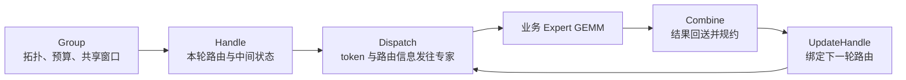

这样拆分的原因是三类信息的生命周期不同：拓扑和通信资源通常长期不变；路由每轮可能变化，但同一路由要同时服务 Dispatch 和 Combine；payload 与输出张量则属于单次调用。Group、Handle 和 per-call config 分别承载这三类信息。

## 2. 硬件与平台怎样约束设计

### 2.1 节点内和跨节点需要不同的传输原语

EP 使用 NCCL 的 LSA 与 GIN 抽象：

| 原语 | 范围 | 实现方式 | 在 EP 中的用途 |
|---|---|---|---|
| LSA | 同一 LSA team，通常是节点内 NVLink/NVSwitch 域 | `ncclGetP2pPtr` 解析对端地址，设备直接 load/store 或 TMA 搬运 | LL 节点内直写；HT 节点内 G2S/S2G 与 fan-out |
| GIN | 跨 LSA team 的网络路径 | `ncclGin::put`、`signal`、`waitSignal` | LL 跨节点消息；HT 跨 team packed payload 与完成通知 |

HT 的 rail/landing-rank 结构如下：

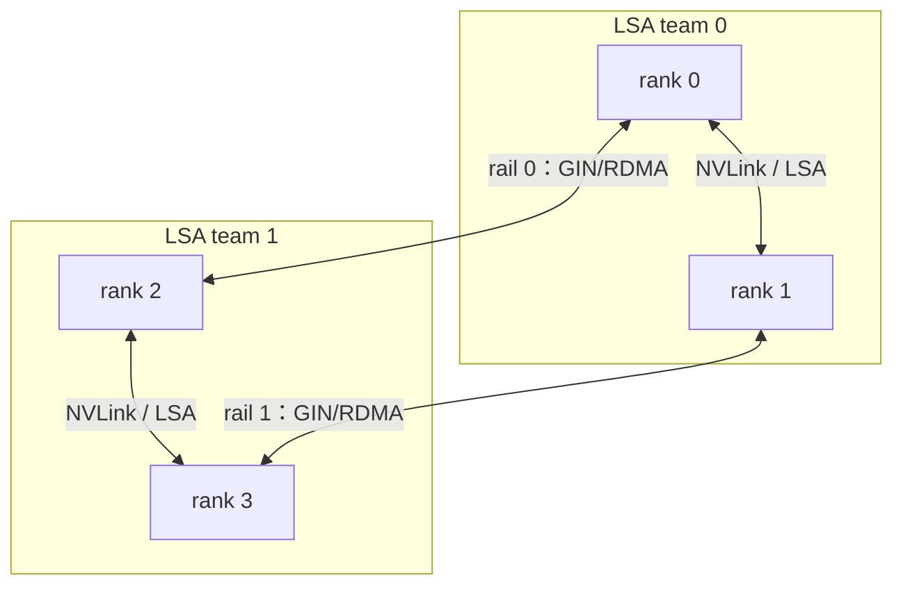

对一份发往特定目标节点的 token 副本，发送方只走一次对应 rail，先到达 landing rank，再由 landing rank 在本地 LSA team 内分发。若同一源 token 因 top-k 需要到多个节点，则每个目标副本分别选择自己的 rail。HT 要求 `rdma_team_size × lsa_team_size == nRanks`，见 `nccl_ep.cc:2762-2789`。

这种分层把“跨节点传输”和“节点内专家复制”解耦：RDMA 只需把节点需要的数据送到 landing rank，本地 NVLink 再完成专家槽位写入。`relativeRankSlot(s,r,R)=(s-r+R)%R` 将不同发送方映射到接收方的不同 source-rank 行，见 `include/common.hpp:258-261`。

### 2.2 GPU 内核需要同时处理搬运和协议

通信发生在设备端，因此地址计算、异步搬运和跨 rank 可见性必须组成同一个协议：

- **TMA**：`cp.async.bulk` 搬运 token 行或 packed bundle。`tma_store_wait<N>` 只等待 SMEM 读阶段；需要保证全局写完成时使用 `tma_store_wait_complete<N>`，再建立跨 rank 可见性，见 `device/device_primitives.cuh:978-1024`。
- **mbarrier**：producer 声明预期传输字节数，consumer 等待对应 stage。普通 store 与 TMA proxy 之间还需要适当的 proxy fence。
- **warp 专用化**：HT 在一个 CTA 内让 G2S、S2G、MAP、PAD、RED、N2N 等角色并行工作，通过 named barrier 和 stage FIFO 衔接。
- **fence 作用域**：sys 域用于跨 GPU 可见性，gpu 域用于同 GPU 的 CTA 间顺序，cta 域用于 CTA 内协议。例如 LL 的 P2P count flag 使用 sys 域，HT 的 `s2d_chunks_ready` 使用 cta 域。
- **架构基线**：EP 基本要求 sm_90+；MXFP8、NVFP4、CFT、NUCS 等特性另有更新的 CUDA、driver 或设备要求，见 `CMakeLists.txt:1-22`。

这里的关键不是单独使用某条指令，而是保证“payload 已写完 → 完成状态可见 → 对端才读取”的顺序。后文所有 flag、guard 和 expected counter 都服务于这个顺序。

### 2.3 CUDA Graph 与 NCCL window 决定准备工作的时机

CUDA Graph capture 不能容纳任意 host 同步、集合通信或资源分配。因此：

- Group 创建、handle 分配和路由预处理应在 capture 前完成；
- HT eager Dispatch 需要 host 获得实际接收量，capture 时被显式拒绝，见 `nccl_ep.cc:6171-6182`；
- HT 固定容量路径使用设备端 expected flag 维持 graph replay 的跨轮顺序；
- LL AUTO RDMA buffer 的扩容不能发生在 capture 中，具体见第 4 章。

NCCL window 让远端 rank 能寻址调用方或库内 buffer。window 注册可能是集合操作，不能当作普通 hot-path 指针赋值。库因此在 Group 创建时注册内部大窗口；调用方若使用 zero-copy，则把 window 和 byte offset 填入 `ncclEpTensor_t`。

NCCL 版本兼容集中在 `validateNcclRuntimeVersion`：拒绝 runtime 旧于 build；build 在 `[2.30.5, 2.31)` 且 runtime 更新时，需要启用 `NCCL_DEV_API_JIT`，未设置时库会自动设置，见 `nccl_ep.cc:2249-2282`。

---

# 第二部分：控制面与生命周期

## 3. Group：先确定所有 rank 共享的协议和资源

### 3.1 为什么 Group 创建是集合流程

远端写入要求各 rank 对窗口布局、缓冲区容量和通信协议有一致理解。Group 创建负责确定这些长期不变的内容：

```text
NCCL 版本检查与 ABI decode
  → 算法、布局和策略校验
  → LSA/rail team 与节点信息
  → SM、接收预算、QP、timeout 和 HT flow
  → workspace 与 HT/LL 共享资源
  → mask/CFT 资源及同步收尾
```

实现入口是 `nccl_ep.cc:2329-3197`。Group 还计算 `num_local_experts`、eager 内部上界和 QP 数量。HT 的 AUTO QP 数量为 `1 + 2 × dispatch_num_sms`：一个是保留 context，其余对应每 CTA 的两个 N2N warp，见 `nccl_ep.cc:2688-2692`。

SM 预算按“算法默认 < `max_num_sms` < op config < `NCCL_EP_COMM_SMS` < op 专用 env”解析，见 `nccl_ep.cc:2519-2589`。这些值会影响 kernel grid、共享缓冲区和 GIN context 数量，所以必须在 handle 创建前确定。

### 3.2 HT flow 不是单纯的性能开关

HT flow 会改变 staging 布局、元数据构建和 Combine 算法：

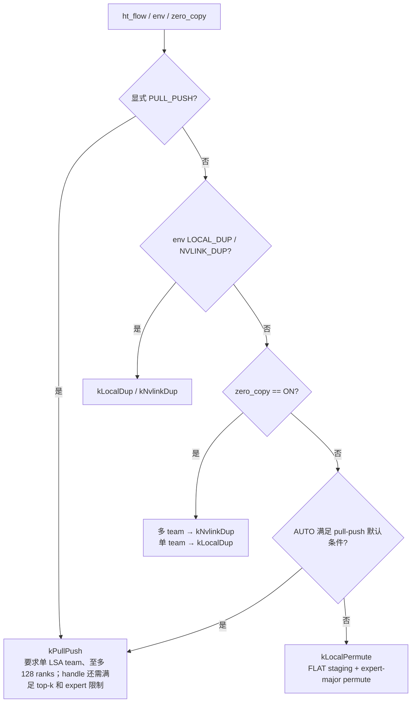

AUTO 默认选择 pull-push 还要求 Group 的 `num_topk` 在 `[1,32]`、专家数不超过 `65535`，且未启用 duplication override，见 `nccl_ep.cc:2791-2860`。显式 flow 的优先级高于相关 env。

这也解释了为什么 zero-copy 不只是少一次拷贝：`zero_copy=ON` 可能把 expert-major 从 local-permute 切换到 local-dup 或 nvlink-dup，从而改变谁负责复制 token 以及 staging 是否分配。

### 3.3 哪些一致性由库验证，哪些必须由调用方保证

“必须全 rank 一致”不等于“库一定会检测到不一致”。当前实现包括：

| 配置或资源 | 当前机制 |
|---|---|
| HT/LL 解析后的 recv budget | `ncclAllGatherHost` 后逐 rank 比较，见 `nccl_ep.cc:2671-2680` |
| HT pull-count capability | AllGather 后比较，避免 peer 计算出不同的 IPC 地址，见 `nccl_ep.cc:1462-1478` |
| LL AFD rank 划分、CFT 选择与平台事实 | 通过 `LlGroupVote` 收集；按所启用的协议检查，见 `nccl_ep.cc:3019-3127` |
| CFT 下的 zero-copy、mask 组合 | 在 CFT vote 中验证；普通 LL 不由此承诺所有配置的一致性检查 |
| HT `ht_flow`、`meta_exchange_policy` 及相关 env | 调用方必须保证各 rank 解析到相同结果；不要依赖库检测所有不一致 |

窗口注册、CFT endpoint 建立等操作还有各自的集合语义。修改 Group 配置时，应先判断它影响的是本地资源、对称布局还是线协议，再决定需要哪种全 rank 校验。

## 4. Handle：把路由准备与每次通信分开

### 4.1 四种入口分别解决什么问题

| API | 作用 | 集合与资源语义 |
|---|---|---|
| `ncclEpInitHandle` | 分配或包装 handle 状态块，确定 layout/top-k | HT 为本地操作；LL AUTO 在首次分配或扩容时是集合操作 |
| `ncclEpUpdateHandle` | 绑定 `topk_idx`，准备本轮路由元数据 | LL 只保存描述符；HT 按 scan/count 路径执行设备预处理，部分路径包含 AllGather |
| `ncclEpCreateHandle` | 合并 Init + Update | 同时承担两者的约束 |
| `ncclEpImportHandle` | 从已准备的 `handle_mem` 和 host 状态重建 handle | HT-only、纯本地；不复制设备状态、不重新 scan |

`num_tokens_set` 用来区分“合法绑定零 token”和“尚未绑定路由”，避免零 token rank 因 `data == nullptr` 被误判为未初始化，见 `nccl_ep.cc:3337-3343, 4881-4882`。

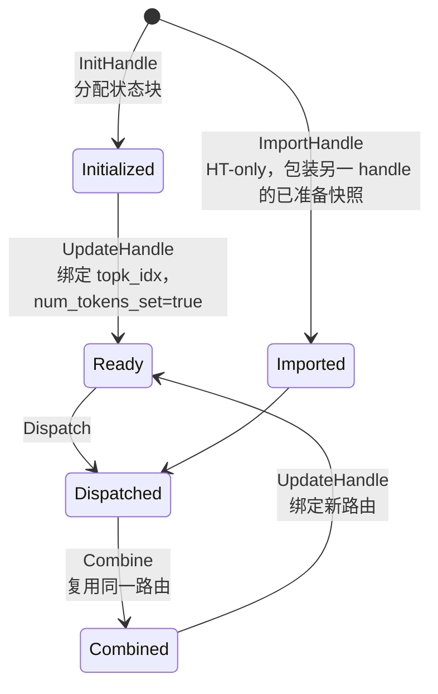

**LL 的 Init 例外必须单独记住。** `rdma_buffer_size=NCCL_EP_AUTO` 时，如果新 `(layout, num_topk)` 需要更大的共享 RDMA buffer，Init 会触发全 rank 扩容。所有 rank 必须以相同参数集合同步调用，不能在途通信，也不能处于 graph capture。显式设置足够大的 `rdma_buffer_size` 后，Init 不再扩容，只检查布局能否容纳，见 `docs/documentation/api_reference.md` 中 `ncclEpInitHandle` 一节及 `nccl_ep.cc:4039-4147`。

### 4.2 ImportHandle 为什么要求特定快照时机

`ncclEpImportHandle` 只重建 host 对象，并信任 `handle_mem` 中已经存在的状态：

- 用于 FWD 时，可以在 `UpdateHandle` 后快照；后续 FWD Dispatch 会重建所需 map。
- 用于 count-mode 的 BWD Dispatch 或 Combine 时，必须等 FWD Dispatch 及其 epilogue 完成后快照，因为这些路径复用 FWD 构建的接收 map。

实现入口和约束见 `nccl_ep.cc:4703-4783`。这使调用方可以把路由状态放入自己的内存池，但快照内容必须与 Group、layout、config 和 `num_topk` 匹配。

### 4.3 host 如何把调用转成设备工作

`ncclEpDispatch` 和 `ncclEpCombine` 先 validate/decode 公共结构体，再检查 recipe、dtype、pass direction 和 handle 状态，最后解析 window、打包参数并选择 kernel，见 `nccl_ep.cc:5535-5609, 7265-7335`。

HT Dispatch 不是一条固定 kernel 链，而是几条互斥或可选分支：

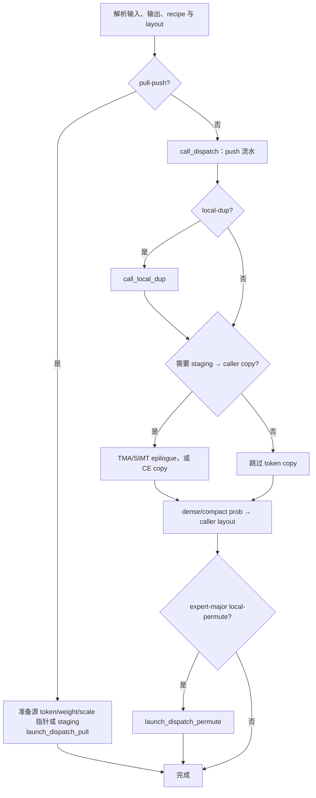

Combine 同样按 flow 分支：pull-push 使用 `launch_combine_push` + `launch_combine_reduce_stage`；local-permute 可使用 `launch_combine_reduce`；其余 HT 路径进入 `ht::call_combine`，见 `nccl_ep.cc:7751-8108`。

### 4.4 ABI：新增字段不能改变旧调用者看到的前缀

参与 ABI 演进的公共配置和参数结构体以 `size`、`magic` 开头，GroupConfig 还携带 API `version`。已发布版本的 `XXX_Vn_LAST_FIELD/SIZE` 冻结前缀，后续字段只能追加；显式 `padding_vN` 用来固定尾部布局，见 `include/nccl_ep.h:30-122`。

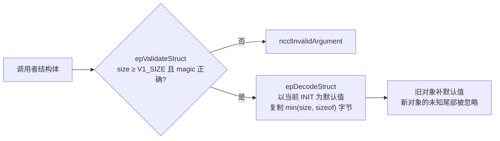

实现见 `nccl_ep.cc:90-148`。公开入口对自己接受的这些结构体执行相应校验；不带此类结构体的 API 没有额外的 decode 步骤。`ncclEpTensor_t` 使用自己的 tensor magic 和校验辅助函数。

---

# 第三部分：LL——围绕小消息延迟组织协议

## 5. LL 为什么使用双 bank 和分阶段调用

小消息场景中，等待整次 Dispatch 或 Combine 完成会占用本可用于模型计算的资源。LL 允许先调用 `send_only` 发起 SEND，再在计算之后用 `ncclEpComplete` 执行 RECV。两次 launch 必须使用同一份 payload 和 signaling 状态，下一轮又不能覆盖仍在使用的数据，因此引入 epoch 和双 bank。

`LowLatencyLayout` 把共享 `rdma_buffer` 分成 signaling 与 payload 两组双 bank：

```text
偏移 0
┌────────────────────────────┬────────────────────────────┐
│ signaling bank 0           │ signaling bank 1           │
│ [signal][read_done][total] │ [signal][read_done][total] │
└────────────────────────────┴────────────────────────────┘
偏移 slot_base = 2 × signal_slot_stride
┌────────────────────────────┬────────────────────────────┐
│ payload bank 0             │ payload bank 1             │
│ [send][recv]               │ [send][recv]               │
└────────────────────────────┴────────────────────────────┘
```

设备用 `bank = epoch & 1` 选择当前 bank，并在协议允许时预清下一个 bank 的 signal/read-done 区域。详细尺寸和复用原因见第 13 章。

## 6. Epoch、Dispatch 与完成通知

### 6.1 split 与 full 调用的 epoch 规则不同

`LowLatencyEpochState{epoch, pending_epoch, send_in_flight}` 记录当前 bank 和 split 调用状态，见 `device/ll/ll_common.cuh:18-72`。

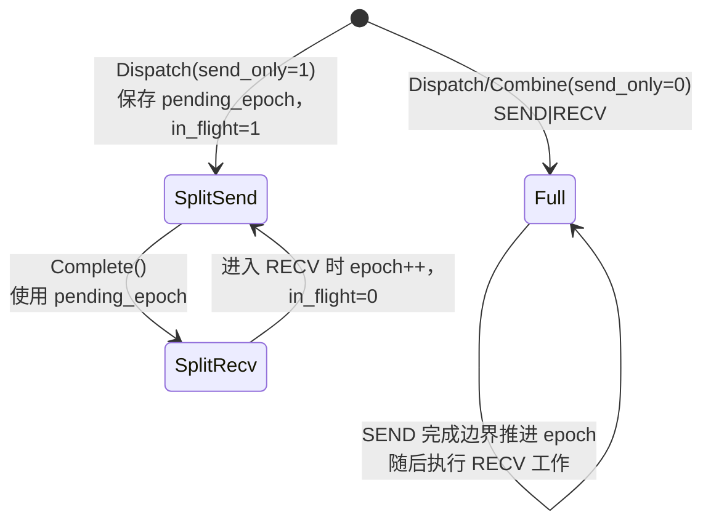

split 模式在 RECV-only 入口推进 epoch；full 模式在 SEND 完成、RECV 处理开始前推进。通用内核用 grid sync 建立边界，LSA 变体由 elected last CTA 推进。send-only 的续跑 lambda 存在 `handle->ll.continue_fn`，`Complete` 调用后清空，见 `nccl_ep.cc:6020-6027, 8131-8144`。

### 6.2 Dispatch 先按 rank 去重，再选择传输路径

一个 token 若选中同一 rank 上的多个本地专家，LL 在线路上只发送一份 token，接收侧再按 layout 组织输出：

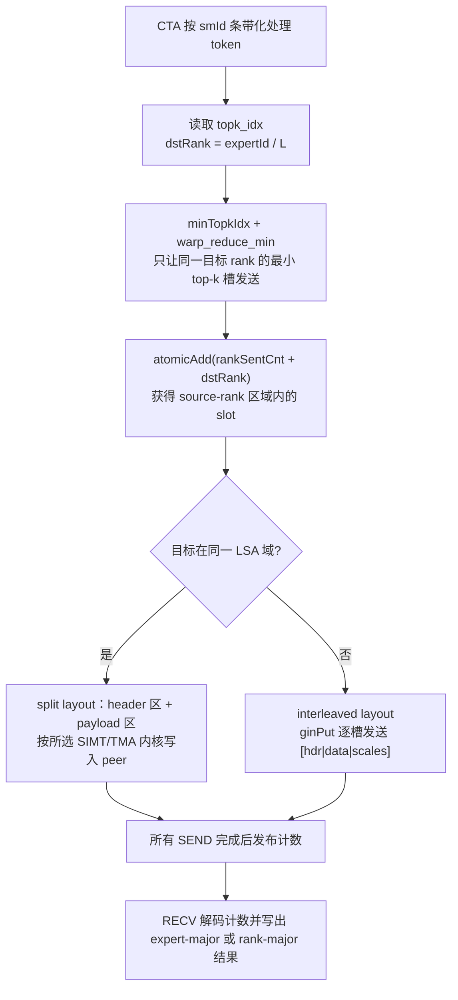

expert-major 接收侧用 `atomicAdd(outCnt[localExpert])` 分配专家区槽位；rank-major 则写入 `[srcRank, slot, :]` 并保存 `topk_idx`、weights 和 source info。AFD 下 dstRank 还要加上 `num_attn_ranks` 的角色偏移。

### 6.3 flag 同时承担“到达”和“数量”两种信息

通用 LL Dispatch 的 P2P 路径向对端写 `-(n+1)`，零表示尚未到达；GIN 路径用 `SignalAdd(n+1)` 累积计数。接收端将两种传输都转换成内部负值，再由 `n = -value - 1` 得到数量，见 `device/ll_ep.cuh:292-385`。

P2P 计数被消费后会清零，供 bank 复用。等待超时且启用 mask 时，接收方将对应 peer 标为失败并设置 host-visible async error；未启用 mask 时则 trap。

### 6.4 为什么需要 SEND 完成点火和 last-CTA 选举

计数不能在某个 CTA 完成自己的 payload 后就立即发布，因为对端需要知道所有 CTA 的发送都已完成。通用内核把每 rank 的 `rankDone` 组织为：

```text
每条消息：       +1
sm0 的预清完成： +FINISHED_SUM_TAG
计数 warp：      +FINISHED_SUM_TAG - countsSent
```

最终达到 `2 × FINISHED_SUM_TAG = 32768` 后，发布方才发送对应计数，见 `device/ll_ep.cuh:825-954`。这个值同时覆盖 payload 完成和 next-bank 清理，避免对端过早推进到下一轮。

LSA 变体不需要完整 grid barrier：每个 CTA 对 `ctaDone` 做 release atomic，`prev + 1 == numSms` 的 CTA 成为 last CTA。它建立 gpu acquire 和 sys release 顺序，向各 peer 发布计数并复位控制计数器。接收侧用 relaxed poll 等待各 peer，再以一次 acquire fence 建立 payload 可见性，见 `device/ll/ll_dispatch_lsa.cuh:319-464`。

## 7. Combine、容错与 LL 变体

### 7.1 2-sided 与 1-sided 的区别是“谁发起读取”

- **2-sided**：专家所在 rank 将结果推到源 rank，并用 finish flag 通知完成。expert-major 在接收侧按 `topkWeights` 加权规约；rank-major 由调用方在 Combine 前预折权重，kernel 使用权重 1，见 `nccl_ep.cc:7365-7377` 和 `device/ll_ep.cuh:2286-2307`。
- **1-sided（pull）**：接收方根据 Dispatch 记录的 `dstInfo`，直接从对端 `inData` window 拉取；read-done 标志防止下一轮覆盖仍在读取的数据。auto 模式在 Dispatch 中根据各 peer 的 token 数和阈值选择，默认阈值为 512。

两条路径使用相同的 epoch/bank 框架，但 1-sided 依赖 Dispatch 留下的源槽信息，因此通用内核回退、拓扑或 recipe 不满足条件时必须 disqualify 1-sided，见 `nccl_ep.cc:3355-3374`。

### 7.2 mask、CFT 与 AFD 改变的是协议，不只是开关

- **Mask**：超时将 `rankMask[peer]` 置 0 并设置 async error。`ncclEpMaskClean` 通过独立 window 做 mask-aware barrier、清理两组 signaling bank 并恢复 mask；它不会自动清除 async error，调用方需另行 `ncclEpErrorClear`。mask 与 CFT 互斥。
- **CFT**：`NCCL_EP_LL_CFT=1` 选择 CUDA logical endpoint、FABRIC 内存和 counted operations 组成的另一条 LL 线协议。它要求单 LSA team、Blackwell+、CUDA 13.3+、driver API 13030 及可用 fabric 环境。所有 rank 必须共同选择；任一 rank 平台不满足条件则 Group 创建失败。CFT 不支持 AFD，也不能与 mask 组合，见 `nccl_ep.cc:3010-3127`。CFT zero-copy 还有更严格的限制：仅支持未量化的 rank-major BF16/FP16，hidden 需为 256 倍数；首次输出绑定必须在 capture 前完成，后续调用保持相同 window、地址、形状和 dtype，见 `nccl_ep.cc:5392-5462`。
- **AFD**：`num_attn_ranks` 把 rank 分为 token-owning attention rank 和 expert-owning FFN rank。角色进入 JIT 特化；A-rank 不执行专家接收逻辑。当前 AFD 要求 square A:F 划分、`num_experts > nRanks`、rank-major、通用 LL 内核和非量化 recipe。

### 7.3 Adapter 把专家几何转成可启动的 grid

LL host 侧先计算：

```text
numWarpGroups   = ceil(numExperts / requestedSms)
numWarpsPerGroup = 32 / numWarpGroups
actualSms       = ceil(numExperts / numWarpGroups)
```

随后检查 `topk + control_warps <= numWarps`，见 `device/ll_ep_adapter.cu:94-138`。DSFP8 shared-quant 路径可能采用更紧凑的 warp 几何，因此上述公式是通用起点，而非所有 recipe 的固定结果。`ll_dispatch_select_algo` 再在通用、LSA SIMT、LSA TMA、CFT 等实现间选择，TMA stage 数由 host 按 SMEM 容量确定。

---

# 第四部分：HT——围绕吞吐和分层传输组织流水

## 8. 元数据：payload 传输前先回答“写到哪里”

### 8.1 动态路由为什么需要独立的控制路径

HT 接收端需要知道每个源 token 是否到达、应写入哪个接收槽、属于哪些本地专家，以及专家区间如何对齐。这些信息被表示为 S2D、LERM、flat2em、counts 和 offsets。若每类 payload warp 都自行扫描 `topk_idx`，不仅会重复工作，也无法保证不同 warp 对同一槽位作出一致判断。

因此 HT 在 `UpdateHandle` 或 FWD Dispatch 中先构建元数据，再让 G2S、S2G、PAD、Combine 共享结果。当前实现不是简单的“scan 或 fused”二选一，而是三条路径：

| 路径 | 何时使用 | 计数交换和表构建的时点 |
|---|---|---|
| scan | 多 LSA team、显式 FORCE_SCAN，或不满足 count 能力的通用回退 | `UpdateHandle` 执行路由 bitmap/top-k AllGather 和跨 block scan，直接生成接收表 |
| unfused count | 单 team count-capable，但 eager、请求 early layout，或 AUTO 下强制 unfused | `UpdateHandle` 执行本地 histogram、count row AllGather 和 early layout 计算；FWD Dispatch 的 MAP warp 再用 gathered rows 建表 |
| fused count | 单 LSA team、固定预算且具体 flow/layout 支持 | `UpdateHandle` 只做本地 histogram/top-k snapshot；FWD Dispatch 的 head 发布计数，MAP warp 建表 |

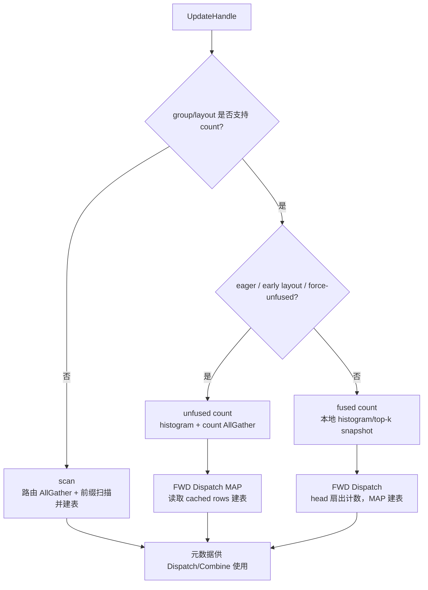

scan 入口见 `device/scan_kernel.cuh:1046-1246, 1394-1680`；count histogram 见 `device/count_kernel.cuh:32-94`。unfused count 的 AllGather 与 layout 输出见 `nccl_ep.cc:4561-4608`，三条路径在通用 scan 前的选择见 `nccl_ep.cc:5192-5216`。

fused count 的接收表只在 FWD Dispatch 后完整可用，所以 count-mode 的 BWD Dispatch 和 Combine 必须先经过一次 FWD Dispatch。这与第 4 章的 Import 快照要求是同一条生命周期约束。

### 8.2 MAP 与数据传输之间仍需就绪协议

fused count 将建表和传输放进同一 kernel，并不意味着消费者可以立即读取 map。MAP warp 按 unit 递增 SMEM 中的 `s2d_chunks_ready`，G2S 和 S2G 都对同一 unit 调用 `s2d_unit_wait`：

```text
MAP：构建 unit → st.release.cta 发布 ready
G2S/S2G：轮询 ready → cta acquire fence → 读取对应 map
```

G2S 读取 `rdma_to_attn_map` 来决定是否取 token，S2G 读取 S2D 来决定写哪里。如果两者观察到的 drop-clear 状态不同，FIFO 的生产/消费次数就会失配并造成死锁，因此二者必须等待同一个 counter，见 `device/ht_ep.cuh:1895-1907, 2073-2105, 2287-2292`。

## 9. Dispatch：把元数据、节点内复制和 RDMA 组成流水

### 9.1 一个 CTA 内的角色分工

HT Dispatch 将大批量工作按 chunk 分到 CTA，再在 CTA 内用 warp 角色形成流水：

| 角色 | warp 几何 | 责任 |
|---|---|---|
| head | 使用 warp 0/1/2；不足时由 filler 补齐 | 初始化 mbarrier、处理 RDMA guard、发布 count row、执行 LSA barrier |
| N2N | 多 team 时每 CTA 2 个 warp | 遍历远端 team，发送 token/prob/scale，按 chunk 发布 tail signal |
| G2S | 每 pipeline 1 个 warp | 判断 chunk 内哪些 token 需要到达，TMA load 到 SMEM stage |
| S2G | 每 pipeline 1 个 warp | 解码 S2D，将 stage 内容写到 peer 的 expert output |
| MAP / PAD | count 模式 MAP 为 2；其他 EM 路径 PAD 为 1 | 构建接收表，或填零 expert-major 对齐 padding |
| tail | elected last block | 等待期望值、清理计数器并推进下一轮 expected flag |

warp 布局入口见 `device/jit/ht_dispatch_jit.cuh:49-80`。S2G 使用 `IN_FLIGHT_S2G=4` 控制尚未释放的 stage，见 `device/ht_ep_configs.cuh:26-33`。

SMEM 拟合使用 `align128(fixed + P × per_pipeline + S × per_stage)` 估算，见 `device/ht_ep.cuh:713-729`。显式 env 配置不会为了适配设备而被静默缩减。chunk 默认在多 team 时为 64，单 team 时为 `round32(4 × dispatch_sms)`；符合调优范围的单 team Dispatch 还可按本轮 token 数选择更小 chunk，见 `ht_chunk_config.hpp:15-85`。

### 9.2 packed entry 是接收布局，不是一次 put 的别名

跨 team 时，N2N 将数据写入接收端的连续 `[token | prob | scales]` entry，便于 G2S 按一个 entry 基址取回各字段。发送端是否只有一次 RDMA 操作则取决于实际字段：

```text
token：一次 net.put
FWD prob：再一次 net.put
有 forwarded scales：再一次 net.put
```

三次调用见 `device/ht_ep.cuh:1295-1368`。`ncclGinOptFlagsAggregateRequests` 允许实现聚合请求，但不改变上层分别描述三个字段的事实。

`__ballot_sync` 先压紧本 chunk 中真正需要发送的 token，再计算 packed entry 的目的偏移。一个 chunk 的所有 put 发出后，才在同一个 QP 上发送 `SignalAdd(..., 1)`，利用 same-QP ordering 让接收方在 tail signal 后读取此前的 payload，见 `device/ht_ep.cuh:1818-1883`。

`GIN_WINDOW=8` 限制单 channel 对每 rail peer 的在途 chunk。queue depth 使用 `min(chunks_per_channel, 8) × (3 × chunk + 1)`，对应每 token 最多三个字段 WQE 和每 chunk 一个 signal，见 `nccl_ep.cc:2099-2104`。

### 9.3 host 分支与 copy epilogue 为什么同时存在

HT 的输入可以先复制到库内 GIN staging，也可以从兼容的外部 window 直接读取。`QUANT_FWD` 会分别决定 token 和 scale 是否需要 staging；普通 recipe 则走 `stage_regular_tokens`，见 `nccl_ep.cc:6075-6153`。

输出侧同样有多条路径：

- 兼容的外部 window 可由通信 kernel 直接写入；
- 固定容量的普通输出默认通过 TMA/SIMT copy epilogue，无需 host 读取实际计数；
- CE 模式、TMA 不可用或地址/行宽不满足 16B 对齐时，会使用 CE copy；在 capture 外，CE 为只复制实际行而执行 D2H count query 和 stream sync；
- eager 需要按本轮实际计数校验调用方容量，因此禁止 capture。

相关决策见 `nccl_ep.cc:6389-6436, 6725-6780`。所以“固定容量”本身不保证没有 host readback，只有 TMA/SIMT epilogue 提供这一性质。

### 9.4 expected flag 让 Graph replay 不依赖 host 每轮重置

HT 将 expected counters 保存在设备内存中。每轮 LSA 完成 flag 按 `ranks_per_lsa_team` 增长，RDMA guard 的 expected 值按 1 增长。dispatch tail 和 combine head/tail 分别完成发布、等待和推进，见 `device/ht_ep.cuh:5445-5479, 5584-5603, 5806-5826`。

因为下一轮期望值由上一轮设备工作自然形成，graph replay 不需要 host 重新写入 flag。该机制解决的是跨轮自定序；它不能替代 capture 前必须完成的资源分配和路由准备。

## 10. Combine 与两种 flow

### 10.1 push-pull：先分层接收，再沿反向路径规约

默认 local-permute 和多 team 路径采用 push-pull：

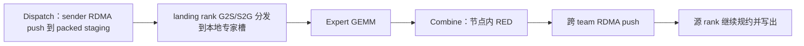

Combine 的 RED warp 使用 `float2 acc[NUM_ACC]` 累积。通用公式为 `NUM_ACC = ceil((H/2) / ((RED_WARPS/P) × 32))`；host 默认降低 pipeline 数使 `NUM_ACC` 不超过 64，显式固定 pipeline 数时可能放弃这一保护，见 `device/ht_ep.cuh:14-26`。MXFP8 在对应 local reduce/RED 路径中反量化后参与 FP32 累加。

`NCCL_EP_HT_COMBINE_RDMA_STREAMING_BATCH=8` 让 RED 每生成一批结果就通知 RDMA warp，而不是等整个 chunk 完成后才启动网络传输，见 `device/ht_ep.cuh:3064-3067`。

### 10.2 pull-push：单 team 下让接收方直接拉取源数据

满足条件的单 LSA team 可采用 pull-push：

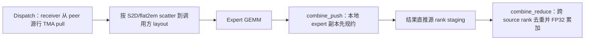

这里省掉的是 push Dispatch 的接收 staging 和部分数据转换，不是所有 staging。非 window pull 回退仍需要源 token、前向权重及可选 scale 的 staging；push Combine 也需要目的端 staging 来汇聚各 expert rank 的部分结果。调用序列见 `nccl_ep.cc:6948-7192, 7784-7858`。

## 11. 动态容量、compact-prob 与 zero-copy

### 11.1 溢出发生在 staging 和调用方输出两个层次

HT 的溢出策略只适用于 HT。接收侧有两个不同容量概念：

1. 库内 staging 按去重后的源 token 计行；
2. 调用方 expert-major 输出按 `(token, local expert)` 对计槽，再加入每专家区间的对齐 padding。

因此，所有 token 都可能装进 staging，但 expert-major 输出仍因复制和 padding 溢出。TRAP 会打印诊断并执行设备 trap，导致 CUDA context 被破坏；DROP 则丢弃越界 assignment，让 Dispatch 和 Combine 继续返回成功。完整语义和例子见 `docs/documentation/overflow_policy.md`。

DROP 的关键顺序是：

```text
越界 slot 置 -1
  → 数据传输跳过该 slot
  → 对外计数按容量 clamp，但 recv_total_counter 保留 pre-drop 总数
  → 重计实际 delivered 数量
  → 清理 Combine gate，避免已丢弃工作造成等待
  → 对 phantom row 做 zero-fill
```

phantom row 是“路由仍为它在 EM 输出中保留了容量内槽位，但 staging 中的源 token 已被丢弃”的行。它不一定会被正常 copy 或 PAD 写到，因此需要显式清零。此时 `expert_counters[e]` 是安全消费所需的上界，不一定等于实际交付行数。

DROP 不允许缩小调用方 buffer：地址计算仍以固定 `max_recv_tokens_per_rank` 为容量。调用方通过比较 pre-drop 的 `recv_total_counter` 与该预算检测丢弃。

### 11.2 eager 改变调用方输出的分配时机，而不是取消内部上界

`max_recv_tokens_per_rank=NCCL_EP_AUTO` 在 HT 中启用 eager：

1. `UpdateHandle` 通过 scan 或 unfused count 提前生成 `recv_total_counter`；
2. 调用方同步并 D2H 读取计数，再按本轮实际接收量分配输出；
3. Dispatch 校验实际输出容量。

EM eager 要求 Group 提供 `num_topk` 上界，FLAT 因按 token 去重而不需要这个乘数。eager 与 DROP、Dispatch graph capture 不兼容，见 `docs/documentation/eager_mode.md`。

对于 EM local-permute，内部容量还要容纳最多 `num_local_experts × (alignment - 1)` 的 padding 冗余，见 `nccl_ep.cc:6472-6482`。dup 模式有自己的 staging 容量约束，不能把这条规则泛化成所有路径都采用同一扩容方式。

### 11.3 compact-prob 只压缩权重和 ID 的线格式

HT push 路径的 FWD compact-prob 行为：

```text
[K × FP32 权重][K × uint16 全局专家 ID][padding → 16B]
```

只有完整 payload 严格小于 dense per-LSA-team 行时才启用；pull-push 已直接读取稀疏权重，不使用这种 compact wire，见 `ht_compact_prob.h:13-46` 和 `nccl_ep.cc:3725-3743`。

接收端通过 LERM 判断哪些专家真正有 payload，再读取对应 ID/weight，避免把 EM padding 或未写区域当成有效数据。BWD compact 行只携带按原 top-k 顺序排列的梯度，不再携带 ID，见 `device/ht_compact_prob.cuh:38-164`。

### 11.4 zero-copy 同时影响内存和算法

调用方为 tensor 注册 NCCL window，并在描述符中提供 `win_hdl/win_offset` 后，兼容路径可以直接读写调用方 buffer。`zero_copy=AUTO/OFF` 允许有 window 时直写、没有时回退 staging；`ON` 则要求相应 tensor 必须带 window。

HT 中 `ON` 还会改变 expert-major flow，并省略非 pull-push 的 IPC token staging。`QUANT_FWD` 的 scales 原本放在 token 槽尾部 slack 中；token staging 被省略后，`outputs->scales` 也必须使用兼容 window。LL zero-copy 只作用于 Dispatch，Combine 仍使用自身 staging 协议。完整条件见 `docs/documentation/zero_copy.md`。

---

# 第五部分：缓冲区与所有权

## 12. 动态路由为什么仍需要静态地址

对端执行 RDMA put 或 NVLink store 时，不能等到达后再让接收方临时分配地址。库必须提前约定窗口基址、区域 offset、行 stride 和最大容量；动态路由只决定本轮使用其中哪些槽位。

由此得到四条分配原则：

| 原则 | 实现方式 | 解决的问题 |
|---|---|---|
| 静态容量、上界预留 | staging 按 token/slot 上界和 `max_token_bytes` 分配 | peer 可按“槽号 × stride”直接寻址，不依赖本轮 host 分配 |
| 合并远端可达区域 | IPC/GIN 各自使用大窗口，内部按 offset 切段 | 减少集合注册次数；每个 peer 解析一个基址后即可派生各区域地址 |
| 互斥区域复用 | 按生命周期共享或别名，并取各场景所需最大值 | 降低 LL payload、AFD 等场景的显存占用 |
| LL handle 保存 offset | 使用时再结合当前 `group->rdma_buffer` 得到地址 | AUTO 集体 realloc 后，已有 handle 不会因缓存旧基址而失效 |

按分配方式，内存主要分为：

| 类别 | 分配器 | 窗口与生命周期 |
|---|---|---|
| HT 节点内 IPC mega-buffer | `ncclMemAlloc` | 对称 window，Group 生命周期 |
| HT 跨节点 GIN mega-buffer | `ncclMemAlloc` | GIN window，Group 生命周期 |
| LL 共享 RDMA buffer | `ncclMemAlloc` | 可随 handle 需求集体扩容，Group 生命周期 |
| Group scratch / workspace | 默认或自定义 `alloc_fn` | 不进 NCCL window，部分按需分配 |
| handle 状态块 | `alloc_fn` 或调用方 `handle_mem` | handle 生命周期；Import 可重新包装已准备内容 |

自定义 allocator 只覆盖不进入 NCCL window 的内存。库内窗口内存由 `ncclMemAlloc` 分配，以满足对称注册和远端可达要求；`cudaHostAlloc` 用于 mapped host 指针表和 host-visible 状态，见 `nccl_ep.cc:2448-2458`。

## 13. LL：用一块窗口承载两种操作和两轮在途状态

### 13.1 尺寸来自线格式和最大槽数

`LowLatencyLayout` 的核心公式为（`include/common.hpp:443-583`）：

```text
num_bytes_per_dispatch_msg =
    align(4 + topk × routerSize, 16) + max_token_bytes

num_bytes_per_combine_msg =
    align((max_token_bytes / 2 / 128) × sizeof(bfloat162)
          + max_token_bytes, 16)

经典 EP：
slot_bytes = max(dispatch_send + dispatch_recv,
                 combine_send + combine_recv)

signaling_buffer_bytes = max(L × R, E) × 4
signal_slot_stride = align(signaling + read_done + total_token, 128)
total_bytes = 2 × (slot_bytes + signal_slot_stride)
```

`routerSize` 在 rank-major 中为 8，因为 header 携带权重；expert-major 中为 2。combine send 的区域在 expert-major 下按专家数分配，在 rank-major 下按有效 token rank 数分配；dispatch recv 则按有效 source-rank 行数分配。

AFD rank-major 中，一个 rank 在一次操作里只承担 sender 或 receiver 角色，因此 dispatch-send、dispatch-recv、combine-send、combine-recv 四个逻辑区域可以别名到同一个 `slot_base`，`slot_bytes` 取四者最大值。各 rank 仍保持一致的窗口布局。AFD 的 `L` 按 FFN rank 数计算，signal 区不能简单套用经典 EP 的 `E/R`。

### 13.2 为什么 Dispatch 和 Combine 能共享 payload

两种操作不并发执行，且各自在 kernel 退出前已把接收 payload 拷贝到用户 tensor；接收区不需要跨操作保存状态。因此经典 EP 只需为两种操作的 `(send + recv)` 组合取最大值，而不是分别保留两组独立区域，见 `include/common.hpp:503-530`。

signaling 采用 bank-major，而不是把 signal、read-done、total-token 各自分成独立双 bank。这样每次 launch 都能用一次线性扫描清理下一 bank 的 signal + read-done。Dispatch 自己不读 read-done，但它的预清会为后续落在该 bank 的 Combine 做好准备。

`total_token` 放在清理范围之后且不清零：每轮由活动 peer 全量覆写，读者只在对应接收计数已就绪后使用它，见 `include/common.hpp:427-436, 549-581`。

### 13.3 LSA 与 RDMA 的槽内布局不同

LSA split layout 将同一 source-rank 区域的 headers 连续前置、payloads 后置，使 payload 可以直接来自用户 `inData`，也便于接收侧扫描元数据。RDMA interleaved layout 则让每槽形成 `[hdr | data | scales]`，一次 `ginPut` 能描述一条完整消息。两种布局的读取分支见 `device/ll_ep.cuh:387-419`。

### 13.4 AUTO realloc 为什么必须集合且先排空

LL grow 的顺序为：

```text
cudaDeviceSynchronize
  → ncclBarrier
  → deregister 旧 window
  → free 旧内存
  → ncclMemAlloc
  → memset(0)
  → register 新 window
```

本地排空还不够，因为远端可能仍通过 RDMA 访问旧窗口，所以需要跨 rank barrier。注册和释放本身已有集合语义，之后不再额外 barrier。全零初始化建立“尚未到达”的初态。实现见 `nccl_ep.cc:4039-4081`。

要避免 hot path 扩容，可以显式提供足够大的 `rdma_buffer_size`，或在 capture 前集合创建所有会改变尺寸需求的 handle。mask 的 `sync_buffer` 使用独立 window，其大小只依赖 `nRanks`，不随 LL RDMA buffer 扩容。

## 14. HT：按节点内、跨节点和 handle 生命周期拆分资源

### 14.1 IPC mega-buffer 的六段布局

HT 节点内大窗口包含（`nccl_ep.cc:1349-1722`）：

1. dispatch token；
2. dispatch prob；
3. dispatch meta tables：LERM bitmap 与每发送者 `[cnt_rank | cnt_expert]` 行；
4. combine token；
5. combine prob；
6. pull-count meta inbox。

各段尺寸按 256B 向上取整，offset 由前一段累加得到。每 peer 只需对 mega window 做一次基址解析，kernel 再通过 `base + offset` 访问各段。

`skip_token_staging = zero_copy && !pull_push`：普通 zero-copy 可省略两个 token 区；pull-push 的非 window 回退仍需源 token 和前向权重，因此保留。`QUANT_FWD` 没有独立 scale 区，而是从 token 槽尾部 slack 切出；staging 被省略时，调用方必须为输出 scales 提供兼容 window。

Group 创建时还没有 handle，因此用 `dispatch_push_count_capable(group, EXPERT_MAJOR)` 做假想能力探测，为未来 handle 预留接收表。pull-count 的区域是否存在的判定必须全 rank 一致，否则 peer 会基于不同布局计算 NVLink 地址，见 `nccl_ep.cc:1435-1478`。

### 14.2 小组件为什么独立分配

- `dev_counter_block` 为 40B，保存 expected GIN/LSA flag 与 grid/head 计数器。设备常驻 expected 值是 Graph replay 自定序的基础。
- `host_ptr_block` 是 `cudaHostAllocMapped` 的七组 per-LSA-rank 指针数组，通过 kernel 参数供设备读取；每次调用可更新其中的窗口派生指针。
- `completion_flags_base` 含两个 `uint32_t`，分别用于 Dispatch 和 Combine 的 LSA S2G 完成汇聚，二者都解析到 LSA rank 0。
- `global_topk_idx` 仅用于 pull 路径，按 `nRanks × max_dispatch × MAX_NUM_TOPK × sizeof(uint16_t)` 分配。
- `global_routing_map` 用于非 pull 路径，是按每 LSA team 专家数进行字节对齐的 bitmap，尺寸不依赖 `MAX_NUM_TOPK`。二者按 flow 二选一，见 `nccl_ep.cc:2933-2961`。

`scan_scratch` 拆成 `token_rank_mask`、`preprocessing_scan_tmp`、`token_to_recv_slot` 三个独立 lazy allocation。若合并为可增长的一块，后续 EM handle 触发扩容会使已有 handle 缓存的设备指针失效，见 `nccl_ep.cc:3977-4003`。

### 14.3 GIN mega-buffer 按方向和协议切段

跨节点大窗口包含 combine RED/G2S tokens 与 probs、G2S flags、guard、token staging、dense prob、RDMA send/recv packed 等区域，见 `nccl_ep.cc:1868-2129`。

RED 与 G2S 必须分开：RED 是“本地规约后将发往远端”的区域，G2S 是“远端数据已到达、等待本地 fan-out”的区域。二者的生产者、消费者和 guard 方向不同；共享会让本地写与尚未消费的远端落盘数据相互覆盖。

GIN 各段当前按 4096B 对齐。接收端 packed entry 的分配按 dense 保守尺寸预留，运行期选择 compact 时只缩小实际 wire 行，不改变既有窗口布局。put 和 signal 的数量关系见第 9.2 节。

### 14.4 workspace 与 handle preprocessing block 不是同一种内存

Group 的 `ep_workspace` 同时承载 LL/HT 计数区和 EM scan 的 gscratch：

```text
ht_count_only ? align256(counter_region) : 32 MiB
```

32 MiB 是 EM scan gscratch 的固定容量；实际所需值由 team、专家数和 block 数计算，并在使用时检查是否超过容量，见 `nccl_ep/device/ht_ep_adapter.cu:1045-1067`。按 block 数计算的 ranks scan tmp 位于独立的 `scan_scratch.preprocessing_scan_tmp`，不应与这 32 MiB 混为一谈。

handle 的 `preprocessing_block` 则按初始化方式组织：`zero_region` 清零；S2D + `wire_pos` 填 `0xFF`，使无效位置在 BWD 被跳过；其余区域由本轮 kernel 完整写入。count scratch 中 `own_chunk_rank`、`per_src_lteam_num_tokens`、`own_row` 相邻，因此可用一次 memset 清零。`lerm_landing` 别名 IPC meta table 的 LERM 区，避免额外跨 rank 复制。

## 15. 调用方张量、对齐与所有权

### 15.1 调用方需要为多少行分配空间

- 固定容量模式的 Dispatch 输出至少覆盖 `max_recv_tokens_per_rank`，也是 Graph capture 所需模式。
- eager 模式按本轮 `recv_total_counter` 分配；EM 还要遵循第 11.2 节的 top-k 和 padding 约束。
- DROP 不缩小这个分配要求；它只处理路由超过预算时的行为。
- `max_token_bytes` 是单行物理字节预算，包含随 token 转发的 scales；HT 要求其为 16B 倍数，`QUANT_FWD` 要求 `token_bytes + scale_bytes <= max_token_bytes`。

### 15.2 区分正确性对齐与工程布局对齐

| 粒度 | 当前用途 | 应如何理解 |
|---|---|---|
| 16B | `int4` 向量访问、TMA 地址/尺寸、token/scale 行、HT `max_token_bytes` | 属于实际正确性契约；FP4x2 的逻辑 H 需为 32 倍数，使物理 H/2 行满足 16B |
| 128B | LL signal stride、部分 SMEM stage、buffer size 取整 | 服务于 bank/stage 布局和访问效率；不是 window 注册的通用最小粒度 |
| 256B | HT IPC 分段、handle 内部块、部分 CFT 布局 | 保持各段基址一致对齐并简化 offset 派生；不要将其一概解释为 TMA 硬件要求 |
| 4096B | HT GIN mega-buffer 各段 | 当前实现的跨节点窗口布局常量；不要在没有额外架构依据时归因于 NIC/IOMMU 或 GIN put 的硬性粒度 |

CFT 的 endpoint `bind_align` 由运行时 `cuLogicalEndpointGetLimits` 查询，不能等同于固定 256B，见 `nccl_ep_cft.cc:773-778`。

### 15.3 `handle_mem` 把状态所有权交给调用方

调用方可提供 1D `ncclUint8` tensor，`sizes[0]` 至少为 `ncclEpHandleMemSize` 的查询结果。此时 handle 只包装该内存，`owns_handle_mem=false`，销毁时不释放底层 buffer。

这为框架内存池和 `ncclEpImportHandle` 提供了基础，但不消除内容匹配要求：Group、layout、config、top-k 和快照时机都必须正确，CUDA Graph 复用也仍受第 4 章生命周期约束。

---

# 第六部分：支撑机制

## 16. JIT：把运行期已确定的维度变成编译期常量

EP 的变体由算法、layout、dtype、recipe、warp 几何和架构共同决定，AOT 穷举会带来大量无用二进制。host 因而只打包运行期参数，将适合特化的维度交给 JIT 模板。

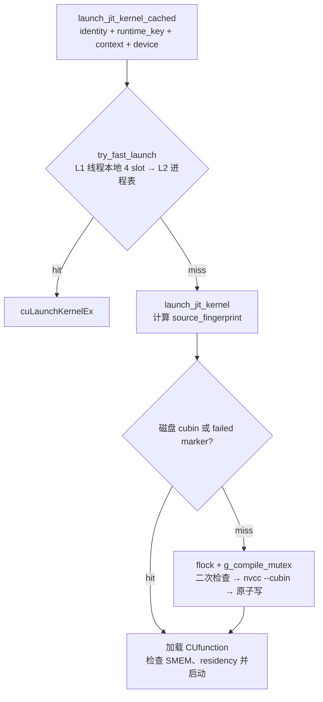

`FastCacheKey={identity, runtime_key, CUcontext, device}`，见 `device/jit/jit_runtime.cc:82-135`。磁盘指纹包含 variant、完整源码、SM/arch、runtime key、编译器身份、相关头文件树和完整编译选项，因此修改头文件、切换编译器或修改 flags 会产生新缓存项。旧缓存不会自动回收。

`jit_source_literals.hpp` 将 layout 和 recipe 等枚举转成模板实参及 cache tag。部署时需要可执行的 `nvcc`、可定位的 EP/NCCL/CUDA headers 和可写缓存目录；relocated 安装可用 `NCCL_EP_HOME` 或更具体的 `NCCL_EP_JIT_*` 变量，详见 `docs/documentation/jit.md`。

## 17. 量化 recipe：减少 wire 字节，但不改变路由协议

| Recipe | 可用范围与前提 | 机制 |
|---|---|---|
| `NCCL_EP_DISP_QUANT_FWD` | LL/HT Dispatch；token/scale 物理行及基址或 window offset 满足 16B；`round_scales=0` | 按物理字节转发 token 和调用方提供的 scales，不规定 scale-block 语义 |
| `NCCL_EP_DISP_QUANT_DS_FP8E3M4` | LL Dispatch；BF16 输入，hidden 为 512 倍数 | 内部生成 E4M3 token 和每 128 元素一个 FP32 inverse scale |
| `NCCL_EP_COMB_QUANT_NVFP4` | 实验性 LL Combine；CUDA 12.9+、E2M1 FP4-family GPU、BF16 输入输出 | 使用 E2M1 和调用方提供的 FP32 全局 scale：通常为 `2688/amax`，`amax=0` 时为 0；hidden 为 512 倍数 |
| `NCCL_EP_COMB_QUANT_MXFP8` | HT Combine；单 LSA team、BF16 输入输出、hidden 为 512 倍数，且选择存在量化实现的 expert-major local-permute/push 路径 | 内部生成 E4M3 和每 32 元素一个 E8M0 scale；调用方不传 scales |

`QUANT_FWD` 中的 FWD 表示“转发 scales”，不是 forward pass；它可用于 FWD/BWD Dispatch，但不能据此推断 Combine 也接受该 recipe。

MXFP8 不能仅从“HT Combine”推断可用：多 team、FLAT 和没有量化 prologue 的 duplication 路径会被拒绝。当前实现同时覆盖 PUSH_PULL 的 local-permute 和 PULL_PUSH 的 push Combine；AUTO 在满足 pull-push 条件时也可进入后者。运行期校验见 `nccl_ep.cc:571-605, 7759-7772`，对应路径测试见 `tests/test_mxfp8_combine.cu:207-215, 342-369`。

MXFP8 解码用 `e8m0_to_scale(e)=__uint_as_float(uint32(e)<<23)` 得到 `2^(E-127)`。在 CUDA 12.8+ 路径，逆 scale 使用 E8M0 转换；兼容编译路径对 `e=0xFE` 特判为次正规数 `0x00400000`，避免 Inf 块经零逆 scale 变成 NaN，见 `device/mxfp8_quant.cuh:25-81`。

`combine_recipe_traits` 主模板故意不定义。新增 recipe 时必须补齐几何和转换实现，而不能静默继承其他格式，见 `device/quant_recipe.cuh:26-28`。

## 18. 部署、诊断与修改约定

常用诊断和调优入口包括：

- `NCCL_EP_DEBUG`、`NCCL_EP_ENV_VERBOSE`；
- `NCCL_EP_HT_PULL_PUSH`、`NCCL_EP_HT_AG_SCAN_MODE`、`NCCL_EP_HT_COUNT_UNFUSED`；
- `NCCL_EP_COMM_SMS`、`NCCL_EP_DISPATCH_SMS`、`NCCL_EP_COMBINE_SMS`；
- `NCCL_EP_TOKENS_PER_CHUNK`、`NCCL_EP_DISPATCH_LSA`、`NCCL_EP_COMBINE_LSA`；
- `NCCL_EP_LL_CFT`；
- `NCCL_EP_HOME`、`NCCL_EP_JIT_CACHE_DIR`、`NCCL_EP_JIT_NVCC` 及其他 JIT 路径变量。

环境变量在 `nccl_ep_env.cc` 集中解析。涉及 flow、线协议、对称布局或集合资源的变量通常需要全 rank 一致；是否由库检测，应按第 3.3 节和对应实现逐项判断。

工程约定方面，`.clang-format-ignore` 排除 `nccl_ep/**`；代码风格和文档流程分别见 `docs/agents/CODING_SKILL.md`、`docs/agents/PLC_DOCS_SKILL.md`。提交遵循项目的 DCO 要求。

---

# 附录 A：术语表

| 术语 | 含义 | 在 EP 中的作用 |
|---|---|---|
| CFT | Compute Fabric Transport | LL 可选线协议，使用 logical endpoint、FABRIC 内存和 counted operations |
| counted ops | logical endpoint 的计数操作能力 | CFT 用硬件字节计数判断 payload 到达；不是 CFT 的展开 |
| logical endpoint | CUDA 13.3+ 的 `cuLogicalEndpoint*` 对象 | CFT 的收发端点，经 export/import 在 rank 间交换 |
| LSA | Load-Store Accessible | 节点内通过 NVLink 直接 load/store 对端显存 |
| GIN | GPU-Initiated Networking | NCCL 的设备端 RDMA put/signal/waitSignal 原语 |
| LSA team | 同一 LSA 域内的 rank 集合 | 决定哪些 rank 可直接进行 P2P 访问 |
| rail team | 跨 LSA team、按节点内 rail 编号组成的 rank 集合 | 承载 HT 的分层跨节点传输 |
| landing rank | rail put 的接收 rank | 代表目标 LSA team 收下数据，再进行本地 fan-out |
| GIN context / QP | GIN 通信上下文/队列对 | HT AUTO 数量为 1 个保留项加 2 × dispatch SMs |
| LERM | Local Expert Routing Map | 每接收槽的本地专家位图，指导 expert GEMM 与 compact-prob 解码 |
| S2D | Sparse-to-Dense map | 将稀疏路由映射到接收槽 |
| flat2em | flat slot → expert-major slot 映射 | FLAT 接收转 expert-major 输出时使用 |
| zone | expert-major 输出中每个专家的连续区段 | 按 `dispatch_output_per_expert_alignment` 对齐 |
| phantom row | DROP 时有 EM 槽但无 staging 源数据的行 | 必须 zero-fill，避免消费陈旧数据 |
| packed entry | HT RDMA 接收区的 `[token|prob|scales]` 单元 | 提供连续接收布局；发送端仍分别描述各字段 |
| compact-prob | 权重和专家 ID 组成的 16B 对齐紧凑行 | 仅在完整行严格小于 dense 时启用 |
| scan | 通过 AllGather 和跨 block 前缀扫描生成接收表 | 通用 HT 元数据路径，在 UpdateHandle 中执行 |
| unfused count | histogram + count AllGather，但不在 Dispatch 内建表 | 服务 eager、early layout 和强制 unfused |
| fused count | 将计数发布和接收表构建融合进 FWD Dispatch | 要求单 LSA team、固定预算及受支持的 flow/layout |
| eager mode | `max_recv_tokens=AUTO`，调用方按实际接收量分配 | HT-only；禁 Dispatch graph capture 与 DROP |
| zero-copy | 用用户 NCCL window 直接读写而非经过兼容的库 staging | 同时影响内存占用和 HT expert-major flow |
| epoch / bank | 双缓冲轮转编号 / 缓冲区组 | `bank=epoch&1`，让 split 调用和相邻轮次使用正确状态 |
| parity | CFT 等协议的双缓冲轮次 | 隔离相邻 Dispatch 的接收状态 |
| guard | 跨轮 WAR 同步标志 | 防止上一轮 RDMA 写覆盖本轮正在使用的 buffer |
| AFD | Attention-FFN Disaggregation | `num_attn_ranks` 划分角色，`ncclEpAf*` 提供包装器 |
| NUCS | NVLink Utilization-Centric Scheduling | CUDA 13.3+ 的 launch attribute，需要相应构建和 driver 支持 |
| TMA | Tensor Memory Accelerator | `cp.async.bulk` 异步搬运 token 行或 bundle |
| mbarrier | 共享内存 barrier 与传输字节计数 | 流水线 producer/consumer 握手 |
| CTA / warp group | CUDA 线程块 / 块内 warp 分组 | HT 按 warp 组分工，并按每 CTA 一 SM 的模型组织通信 grid |
| cooperative launch / cluster | CUDA grid 同步 / 集群启动能力 | 通用 LL 使用 `cg::this_grid().sync()`；cluster 提供分布式 SMEM 能力 |
| decoupled look-back | 前缀扫描中 block 查看前驱状态的算法 | scan 路径的跨 block 前缀和 |
| runtime_key / fingerprint | JIT 的内存快键 / 磁盘指纹 | 前者服务快速启动，后者覆盖源码、头树和编译环境 |
| cubin | nvcc 生成的 GPU 二进制 | JIT 磁盘缓存的主要产物 |
| DSFP8 / MXFP8 / NVFP4 | 三种内部量化格式 | 分别用于 LL Dispatch、HT Combine、LL Combine |
| `max_token_bytes` | 单 token 行含 scale 的物理字节预算 | 决定 staging 行宽；HT 要求 16B 倍数 |
| 1F1B | One-Forward-One-Backward 流水调度 | 通过同 Group 多 handle 保存不同 micro-batch 的路由状态 |
| host-NUMA | 与 GPU 同 NUMA 节点的 CPU 内存 | 弹性缓冲区的 CPU 段；由对应 kernel 访问 |
| SONAME / ABI / DCO / PLC | 共享库版本名 / 二进制接口 / Developer Certificate of Origin / 项目文档体系 | 分别涉及库加载、结构体兼容、提交签署和文档流程 |

# 附录 B：关键不变量

1. **Group 一致性**：recv budget、pull-count capability 和 CFT vote 有各自的全 rank 校验；HT flow/meta policy 等仍要求调用方保证一致，不能假设所有错误都会被库检测。
2. **HT flag 期望值**：LSA expected 每轮按 `ranks_per_lsa_team` 推进，RDMA expected 每轮加 1；二者是不同计数域。
3. **LL bank 轮转**：split 在 RECV-only 入口推进；full 在 SEND 完成边界、RECV 处理前推进。SEND-only 与 Complete 必须使用同一 pending epoch。
4. **S2D ready-counter**：G2S 与 S2G 必须等待同一 unit 的 `s2d_chunks_ready`，否则可能对 drop-clear 作出不同判断并破坏 FIFO。
5. **DROP 顺序**：越界槽置无效并跳过 → clamp 计数且保留 pre-drop 总数 → 重计 delivered → 清 Combine gate → zero-fill phantom row。
6. **量化约束**：16B 是实际向量/TMA 契约；DSFP8、MXFP8、NVFP4 的 hidden、拓扑、layout、flow 和 dtype 限制必须分别满足。
7. **LL 协议编码**：P2P 到达计数写 `-(n+1)`；通用内核的 `FINISHED_SUM_TAG=16384`、完成目标为 `32768`；LSA 以 `prev+1==numSms` 选举 last CTA。
8. **LL offset-only**：已有 handle 保存相对布局，AUTO 集体 realloc 后使用新的 `group->rdma_buffer` 基址。
9. **窗口与 allocator**：进入 NCCL window 的库内存由 `ncclMemAlloc` 分配；自定义 allocator 只覆盖不进入 window 的块。
10. **资源析构与方向隔离**：window 先于其内存释放，devComm 先于 comm；HT RED 与 G2S 区域物理分离并使用各自的同步语义。

# 附录 C：源码索引

| 主题 | 位置（`nccl_ep/` 下） |
|---|---|
| API / ABI | `include/nccl_ep.h`、`include/ep_enums.h` |
| 常量 / LL 布局 | `include/common.hpp:18-51, 375-625` |
| Group / Handle / Ops | `nccl_ep.cc:2329` / `:3330` / `:5535, 7265, 8131` |
| HT 资源布局 | `nccl_ep.cc:1349-1722`、`:1868-2129` |
| UpdateHandle 决策树 | `nccl_ep.cc:4840-5273` |
| LL epoch / 计数 | `device/ll/ll_common.cuh:18-72`；`device/ll_ep.cuh:825-954` |
| LL 内核 | `device/ll_ep.cuh:497, 1780`；`device/ll/*.cuh` |
| 内存原语 | `device/device_primitives.cuh` |
| HT 元数据 | `device/count_kernel.cuh:32`；`device/scan_kernel.cuh:1046, 1394` |
| HT 内核 | `device/ht_ep.cuh:5137, 5519, 8375, 8752` |
| HT 策略 | `ht_chunk_config.hpp`、`ht_sm_policy.hpp`、`device/ht_ep_configs.cuh` |
| JIT | `device/jit/jit_runtime.cc`、`device/jit/nvcc_compiler.cc`、`device/jit/jit_source_literals.hpp` |
| 量化 | `quantization_recipe.hpp`、`device/quant_recipe.cuh`、`device/mxfp8_quant.cuh` |
| CFT | `nccl_ep_cft.cc`、`nccl_ep_cft.h` |
| 专项文档 | `docs/documentation/*.md`、`docs/release/*.md`、`docs/agents/*.md` |
