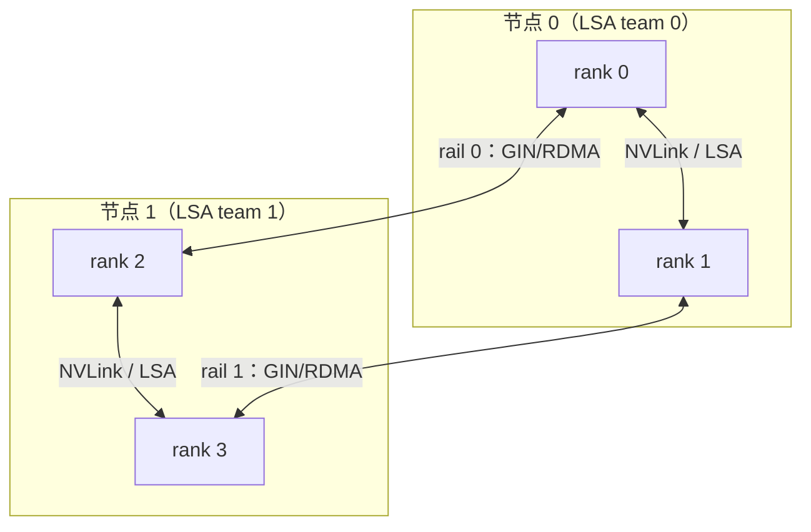
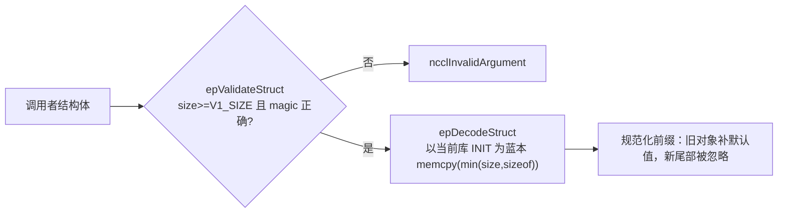
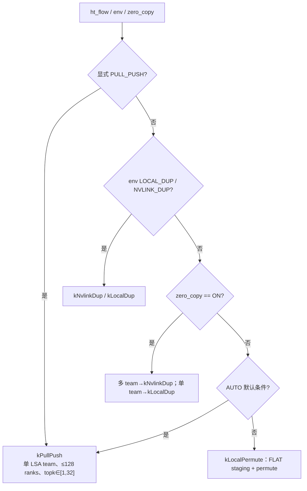
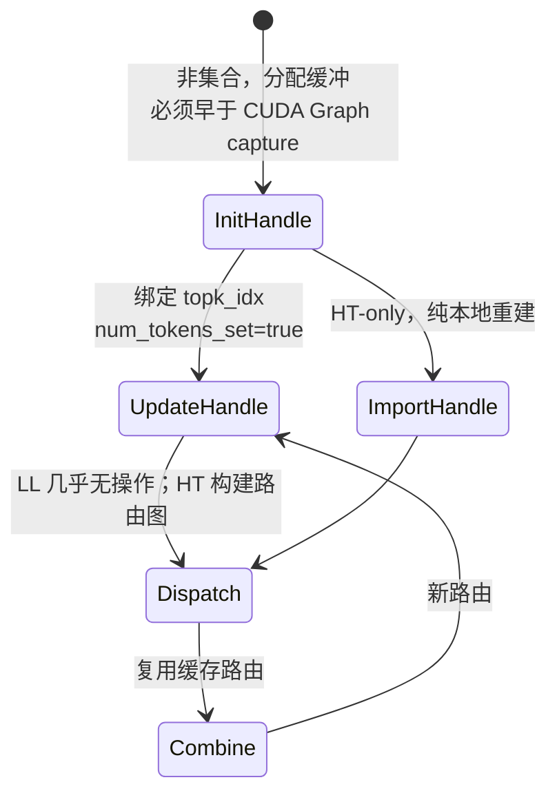
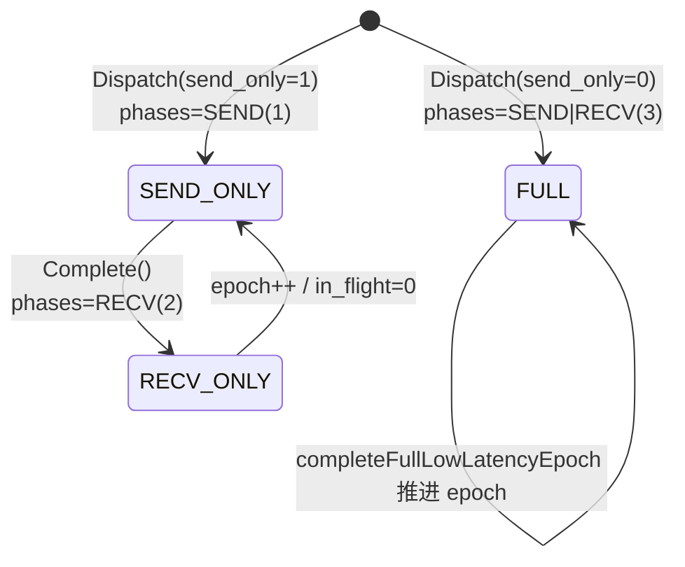
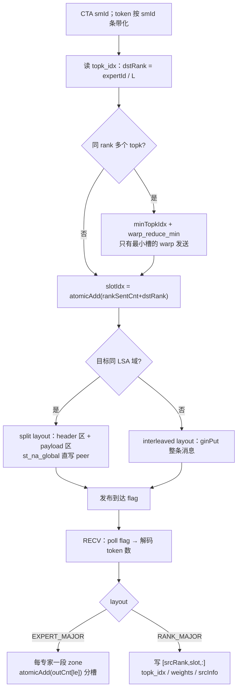
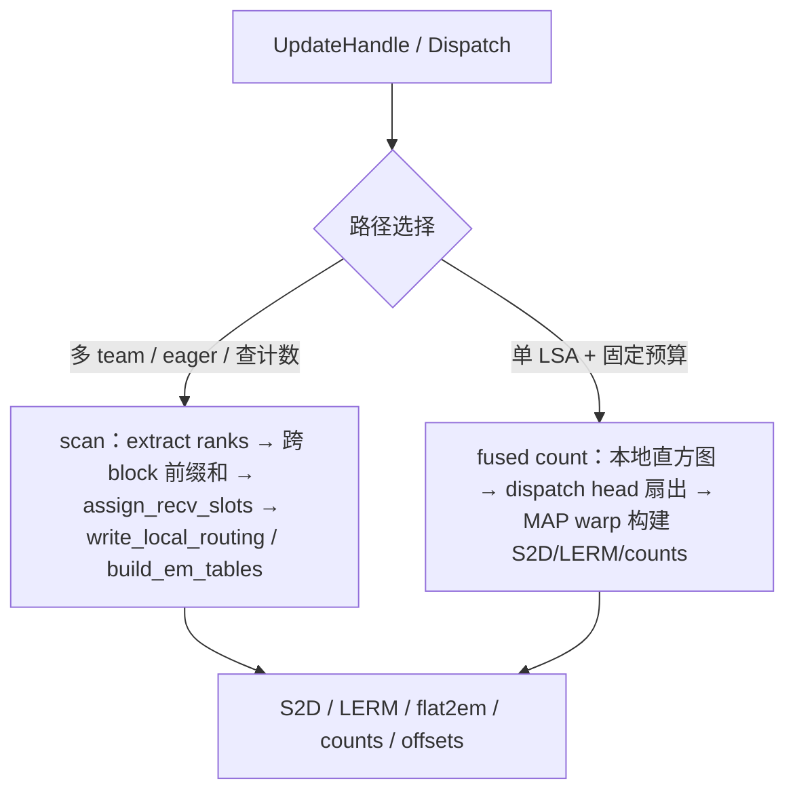
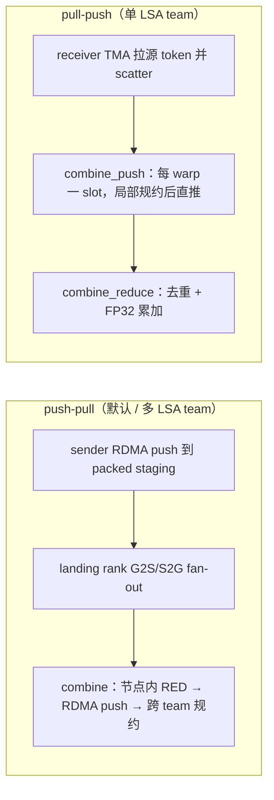
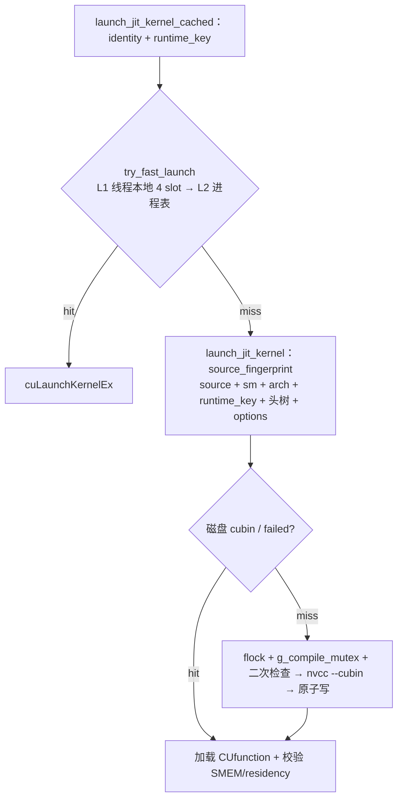

# NCCL EP 深度设计解析：业务问题 → 设计取舍 → 代码实现

> 本文基于对 `nccl_ep/` 源码与全部设计文档的完整通读。组织方式遵循一条主线：**先讲清业务场景要解决什么问题，再讲硬件与平台给出了哪些约束，最后解释代码如何在这两者之间做取舍**。所有 `file:line` 均相对于 `nccl_ep/`。术语表见 [附录 A](#附录-a-名词解释重点术语)。

## 阅读地图：每章解决什么问题

| 章节 | 要解决的问题 | 解决思路 | 关键代码 |
|---|---|---|---|
| 1 MoE 通信需求 | 为什么需要专门的 EP 库 | 把动态路由的两次 all-to-all 固化为 Dispatch/Combine | `include/nccl_ep.h` |
| 2 两类业务场景 | 为什么一套 API 要有两套内核 | 推理 decode→LL；训练 prefill→HT；多 handle 支持 1F1B | `nccl_ep.cc:2329`, `docs/documentation/usage_examples.md` |
| 3 集群通信层次 | 数据怎么跨 GPU/跨节点 | LSA（节点内）+ GIN（跨节点 rail + landing rank） | `nccl_ep.cc:2417, 2762-2789` |
| 4 GPU 内核能力 | 如何在设备端高效搬运与同步 | TMA/mbarrier/warp 专用化 + sys/gpu/cta 三级 fence | `device/device_primitives.cuh` |
| 5 平台约束 | 为什么 API 要拆成 Group/Handle | CUDA Graph、window、NCCL 版本兼容 | `nccl_ep.cc:2249, 4840` |
| 6 ABI | 库升级如何不破坏已编译应用 | append-only 结构体 + validate/decode | `nccl_ep.cc:90-148` |
| 7 Group 创建 | 如何一次性把拓扑与资源定死 | 32 步集合流程 + 全 rank 投票 | `nccl_ep.cc:2329-3197` |
| 8 Handle 生命周期 | 如何复用路由并支持 capture | Init/Update/Create/Import 四种入口 | `nccl_ep.cc:3330-3573` |
| 9 主机编排 | host 如何把意图转成 kernel 序列 | 决策树 + 参数打包，模板交给 JIT | `nccl_ep.cc:5535-8129` |
| 10–14 LL | 小消息如何做到微秒级 | 双 bank epoch + flag 协议 + LSA/TMA | `device/ll_ep.cuh` |
| 15–18 HT | 大消息如何打满两条链路 | 分层流水 + scan/count 元数据 + flow 选择 | `device/ht_ep.cuh` |
| 19–23 缓冲区设计 | 静态地址与动态路由如何共存 | 上界预留 + 大块对称窗口 + 互斥复用 + offset-only | `common.hpp`, `nccl_ep.cc:1349-2129` |
| 24 JIT | 特化维度爆炸怎么办 | 编译期常量化 + 三级缓存 | `device/jit/jit_runtime.cc` |
| 25 量化 | 如何降低 wire 字节数 | FWD/DSFP8/MXFP8/NVFP4 四种 recipe | `quantization_recipe.hpp` |
| 26 运维与约定 | 如何安全部署与修改 | env / 兼容矩阵 / 编码规范 | `nccl_ep_env.cc`, `docs/agents/` |
| 附录 | 名词、不变量、源码索引 | — | — |

---

# 第一部分：业务场景——为什么需要 EP

## 1. MoE 通信需求

> **本章解决的问题**：MoE 模型中究竟哪一段通信难，难在哪里。
> **解决思路**：把"数据相关的两次 all-to-all"抽象成 `Dispatch`（发送 token 到专家）和 `Combine`（收回并加权规约）。

### 1.1 一次 MoE 层的通信结构

```
Dispatch：token[t] 按 topk_idx[t][k] 发到专家所在 rank
Expert GEMM：各 rank 在本地专家上计算（业务自身的计算）
Combine：专家输出送回源 rank，按 topk_weights 加权求和
```

`num_local_experts = num_experts / nRanks`（`nccl_ep.cc:2628`）。一个 token 被复制到 k 个专家，因此接收侧容量可能是发送侧的 k 倍（expert-major 布局）。

### 1.2 三个核心困难

1. **路由数据相关**：`topk_idx` 每轮变化，接收数量与目标 rank 分布事先未知 → 需要设备端路由解析与动态计数。
2. **top-k 复制**：一 token 多份输出 → 需要 per-expert zone / 对齐 padding / 溢出策略。
3. **延迟与吞吐不可兼得**：推理 decode 要微秒级低延迟；训练 prefill 要打满 NVLink + NIC 带宽 → 催生 LL / HT 两套内核共用一套 API。

### 1.3 由此推导出的 API 形态

- `ncclEpGroup`：一次性建立拓扑与资源（集合通信）。
- `ncclEpHandle`：缓存路由（topk_idx）与中间状态，支持复用与多 handle 并发。
- `ncclEpDispatch` / `ncclEpCombine`：每次迭代调用，host 只做校验与参数打包。
- `ncclEpLayoutInfo`：把各类计数器张量作为命名字段传入，避免位置参数歧义。

## 2. 两类业务场景如何决定两套实现

> **本章解决的问题**：为什么不能只写一种内核。
> **解决思路**：按 batch 大小、拓扑跨度、是否需要重叠，把场景映射到 LL 或 HT。

| 业务场景 | 核心诉求 | EP 的设计响应 |
|---|---|---|
| 推理 decode（小 batch） | 单 token 级低延迟、多 micro-batch 重叠 | LL：点到点 P2P、双 bank epoch、`send_only`+`Complete` |
| 训练 / prefill（大 batch） | 高带宽、跨节点扩展 | HT：chunk 流水、LSA+GIN 分层、warp 专用化 |
| 1F1B / 流水并行 | 多个在途的 dispatch/combine | 同一 group 多 handle，路由互不干扰（API docs） |
| Attention-FFN 分离（AFD） | attention 与 FFN 分置不同节点 | `num_attn_ranks` 划分角色，`ncclEpAf*` 包装器 |
| 接收量长尾分布 | 不想为极端 worst case 预留 GPU 显存 | eager 模式 / 弹性缓冲区（GPU+CPU 分段） |
| 带宽/精度权衡 | 降低 wire 字节 | FWD / DSFP8 / MXFP8 / NVFP4 recipe |

`docs/documentation/usage_examples.md` 给出了 HT（含 FWD/BWD）与 LL（expert-major/rank-major）的完整调用序列；`RELEASE_NOTES_v0.2.md` 记录了 1F1B、zero-copy、动态 sizing 等场景的引入动机。

---

# 第二部分：硬件与平台约束——设计可行性的边界

## 3. 集群通信层次

> **本章解决的问题**：token 在物理上如何跨 GPU 与跨节点。
> **解决思路**：利用 NCCL 的 LSA/GIN 抽象与 team 划分，把一次跨节点传输压缩成"一次 RDMA put + 一次 NVLink fan-out"。

### 3.1 LSA 与 GIN

| 原语 | 范围 | 机制 | 用途 |
|---|---|---|---|
| **LSA** | 节点内（NVLink/NVSwitch） | `ncclGetP2pPtr` 拿对端 VA，直接 `st.global`/`ld.global` + sys fence | LL 同域 P2P；HT 节点内 G2S/S2G |
| **GIN** | 跨节点（NIC） | `ncclGin::put` + `SignalAdd` + `waitSignal` | LL 跨节点消息；HT N2N put/signal |

### 3.2 rail team 与 landing rank



每个 token 只跨一次 rail，落到 **landing rank**，再由它在本节点内用 NVLink 分发给真正需要它的专家（`docs/documentation/benchmark_analysis.md:98-120`）。这就是 HT "分层"的物理依据。约束：`rdma_team_size × lsa_team_size == nRanks`（`nccl_ep.cc:2786`）；`relativeRankSlot(s,r,R)=(s-r+R)%R` 把不同发送方在同一接收方的 staging 区错开（`include/common.hpp:258-261`）。

## 4. GPU 内核能力与代价

> **本章解决的问题**：设备端凭什么能"自己完成通信"，以及同步的代价在哪里。
> **解决思路**：把 TMA/mbarrier/warp 特化当作原语，把 fence 作用域（sys/gpu/cta）当作协议设计工具。

- **TMA**：`cp.async.bulk` 搬整块 token bundle；封装在 `device_primitives.cuh:978-1024`。注意 `tma_store_wait<N>` 只等 SMEM 读阶段，`tma_store_wait_complete<N>` 才等全局写完成——跨 rank 可见前必须用后者。
- **mbarrier**：每级流水一对 producer/consumer barrier，`arrive.expect_tx` 声明字节数；`fence.proxy.async.shared::cta` 让普通 store 对 TMA engine 可见。
- **warp 专用化**：CTA 内按 `threadIdx` 区间分工（G2S/S2G/MAP/PAD/RED/N2N），用 named barrier 协作；HT dispatch head 固定占 3 个 warp（`device/jit/ht_dispatch_jit.cuh:52-81`）。
- **fence 三域**：`fence.release.sys` / `fence.acquire.sys` 跨 GPU 可见；`fence.acq_rel.gpu` 用于同 GPU 多 CTA；`fence.acq_rel.cta` 用于 CTA 内——LL 的 count flag 用 sys 域，HT 的 ready-counter 用 cta 域。
- **架构门槛**：EP 基本 sm_90+；MXFP8 需 CUDA 12.8+ 且 hidden%512==0；NVFP4 需 12.9+；CFT 需 Blackwell+/13.3+/driver 13030；NUCS 需 13.3+。

## 5. 软件平台约束

> **本章解决的问题**：为什么 API 必须拆开、为什么需要兼容层。
> **解决思路**：把"含集合通信/分配"的动作放到 capture 之前，把版本差异收敛到 ABI decode 与运行时检查。

- **CUDA Graph**：`CreateGroup`/`InitHandle`/`UpdateHandle`/`MaskClean` 必须在 capture 前；HT eager 的 dispatch 因需 D2H 读计数被显式拒绝（`nccl_ep.cc:6171-6182`）；跨轮同步靠设备 expected flag 自定序。
- **NCCL window**：用户可把 buffer 注册为 window 挂到 `ncclEpTensor_t::win_hdl` 走零拷贝；库自身也用 window 注册 LL `rdma_buffer` 与 HT mega-buffer。
- **NCCL 兼容**：`validateNcclRuntimeVersion`（`nccl_ep.cc:2249-2282`）拒绝 runtime 旧于 build；build∈[2.30.5,2.31) 配新 runtime 时自动设 `NCCL_DEV_API_JIT=1`。

---

# 第三部分：控制面——把用户意图变成全 rank 一致的资源

## 6. API 与 ABI

> **本章解决的问题**：库升级后旧程序还能跑，新字段又能加。
> **解决思路**：append-only 结构体 + 运行期 validate/decode 规范化。

每个公共结构体以 `size` + `magic`（`NCCL_EP_MAGIC=0xC00FFFEE`）开头，GroupConfig 另有 `version`（当前 API v4）；发布版本冻结 `XXX_Vn_LAST_FIELD/SIZE`，`padding_vN` 吃掉隐式填充（`include/nccl_ep.h:30-122, 368-377`）。



`epValidateStruct` / `epDecodeStruct` 见 `nccl_ep.cc:90-148`，所有公开入口均先 validate 再 decode。

## 7. Group 创建

> **本章解决的问题**：把所有会影响线协议/缓冲布局的参数在组创建时一次定死，并保证全 rank 一致。
> **解决思路**：32 步集合流程 + 派生量计算 + `LlGroupVote` 集体投票 + 统一回滚。

关键步骤（`nccl_ep.cc:2329-3197`）：NCCL 兼容检查 → ABI decode → 算法/策略校验 → team 建立 → SM 预算解析 → 节点发现 → 预算/超时解析 → flow 决策 → workspace 分配 → HT/LL 资源初始化 → mask 资源 → 同步收尾。

派生量：`num_local_experts`、`eager_mode`（上界 `nRanks×max_dispatch×max(topk,1)`）、`num_qp_per_rank = 保留 ctx + dispatch_sms×2`。

SM 预算优先级（`:2519-2589`）：算法默认 < `max_num_sms` < op config < `COMM_SMS` < op env。HT flow 决策树：



`LlGroupVote`（`:3019-3027`）把 `num_attn_ranks / want_cft / enable_mask / zero_copy / CFT facts` 全 gathered 校验；不一致 → `reject_group`。HT IPC mega-buffer 切成六段（dispatch token/prob/meta、combine token/prob、pull meta），`skip_token_staging = zero_copy && !pull_push`（`:1349-1722`）。

## 8. Handle 生命周期

> **本章解决的问题**：路由既要跨迭代复用，又要在 capture 前准备完毕。
> **解决思路**：拆分 Init（非集合、分配）与 Update（集合、绑路由），另提供 Import 从快照重建。



`num_tokens_set` 区分"合法零 token rank"与"未绑定路由"（`nccl_ep.cc:4881-4882, 5605, 7312`）。`ImportHandle` 的快照时序要求：FWD 可在 UpdateHandle 后快照；count-mode 的 BWD dispatch/combine 必须等 FWD dispatch 完成后快照。

## 9. 主机端编排

> **本章解决的问题**：host 如何把 config/路由/张量翻译成一串正确的 kernel 与拷贝。
> **解决思路**：严格的校验顺序 + 决策树 + 打包 `*Params`，模板实例化交给 JIT。

**Dispatch 通用前处理顺序**（`nccl_ep.cc:5542-5609`）：validate/decode 全部结构 → 取 `send_only/pass_direction/quant_recipe` → AFD 量化拒绝 → `validateDispatchRecipe` → dtype 校验 → LL 的 BWD 拒绝 → `num_tokens_set`。

**LL Dispatch**（`:5611-6027`）：按 layout 校验 3D 形状 → zero-copy 决策（`nvlink_only && rank_major && recipe_ok`）→ 计算 `want_1sided_combine` → 打包 `ll::DispatchParams` → `phases = send_only ? SEND : SEND|RECV`，send_only 时存入 `continue_fn`。

**HT Dispatch**（`:6028-7260`）：输入 staging（`stage_regular_tokens = 有 staging && 非 FWD && 非外部 window`）→ 输出校验（eager+capture 拒绝）→ prob wire 模式（pull-push 用 dense，否则 `compact_prob_fits` 决定）→ 零拷贝指针数组 → eager count query → 打包 `ht::DispatchParams` → kernel 序列：`call_dispatch` → `local_dup` → copy epilogue → dense→sparse prob → `dispatch_pull` 或 `dispatch_permute`。

**Combine** 同构（`:7265-8129`），pull-push 走 `launch_combine_push`+`launch_combine_reduce_stage`，否则 `launch_combine_reduce` 或 `ht::call_combine`。

---

# 第四部分：LL——解决低延迟点到点

## 10. LL 缓冲布局与双 bank

> **本章解决的问题**：如何在不重新分配的情况下反复使用接收缓冲，并让 SEND-only / Complete 两阶段指向同一份数据。
> **解决思路**：把 buffer 拆成 payload 与 signaling 两组双 bank，用 `epoch&1` 选 bank。

`LowLatencyLayout`（`include/common.hpp:443-583`）：

```
payload bank：dispatch/combine 的 send+recv 共享槽（取组合字节数 max）
signal  bank：[signal][read_done][total_token]，slot_stride 按 128B 对齐
slot_base = 2 × signal_slot_stride；总大小 = 2×(payload + signal)
```

`num_bytes_per_dispatch_msg = align(4 + topk×routerSize,16) + max_token_bytes`，routerSize 为 8（RANK_MAJOR 携带权重）或 2（EXPERT_MAJOR）。设备侧 `bank = epoch&1`，并提前清零 `bank_next` 的信号区（`device/ll_ep.cuh:587-596`）。

## 11. Epoch 协议与 send_only/Complete

> **本章解决的问题**：两阶段调用如何跨 launch 保持一致，且资源能及时释放给计算。
> **解决思路**：`LowLatencyEpochState{epoch, pending_epoch, send_in_flight}` 状态机。



`selectLowLatencyEpoch`（`device/ll/ll_common.cuh:18-40`）由 `(sm0,t0)` 维护状态；推进时机在 RECV 半（重载 B 由 last-CTA 推进，`ll_dispatch_lsa.cuh:927`）。`send_only` 的续跑 lambda 存在 `handle->ll.continue_fn`（`nccl_ep.cc:6025-6027, 8131-8144`）。

## 12. LL Dispatch

> **本章解决的问题**：每个 token 如何找到目标 rank、去重、写对端、再让接收方知道"到了多少"。
> **解决思路**：warp 分工 + 最小 topk 槽去重 + 精确 flag 编码。



**flag 编码**（`device/ll_ep.cuh:292-385`）：P2P 写 `-(n+1)`（0=未到达），GIN 用 `SignalAdd(n+1)`，解码 `n=-value-1`；消费后清零以便 bank 复用；超时则 mask 该 rank 或 `trap()`。

**无 grid 屏障计数点火**（`:935-983`）：`rankDone[dst] = (+1 每消息) + FINISHED_SUM_TAG(sm0) + (FINISHED_SUM_TAG - countsSent)`，三项相加恒为 `2×16384=32768` 当且仅当所有 CTA 的 SEND 完成；发布方 `ld.acquire.gpu` 自旋该值后再发 flag。

**LSA 变体**（`device/ll/ll_dispatch_lsa.cuh:319-413`）：last-CTA 选举替代 grid 屏障——`atomic_add_release(ctaDone)`，`prev+1==numSms` 者执行 `fence.acquire.gpu → fence.release.sys → 逐 peer 发 -(n+1) → 清零 ctaDone`。接收侧 `syncAndRecvCounts` 用 relaxed poll + 一次 acquire fence 并行等待所有 peer。

## 13. LL Combine、容错与 AFD

> **本章解决的问题**：专家输出如何回来并规约；个别 rank 失败时如何不拖垮整组。
> **解决思路**：2-sided/1-sided 两种回传 + mask 位图 + 可选 CFT fabric 路径。

- **2-sided**：发送方 TMA-store 到对端 + finish flag=1；expert-major 在接收侧按 `topkWeights` 加权累加，rank-major 权重由调用方预折（kernel 用 `weight=1`，`ll_ep.cuh:2286-2307`）。
- **1-sided（pull）**：接收方按 dispatch 记录的 `dstInfo` 直接从对端 `inData` window TMA-load，靠 read-done 标志保护下一轮；`auto` 由设备端 `want1SidedBuf` 按阈值 512 自选。
- **Mask**：超时写 `rankMask[peer]=0` + `asyncErrorFlag=1`；`MaskClean` 用独立 window 做 mask-aware barrier 并复位；与 CFT 互斥。
- **CFT（Compute Fabric Transport）**：`NCCL_EP_LL_CFT=1` 开启，用 CUDA logical endpoint + FABRIC 内存 + 硬件字节计数（`cumul_byte_expect_dev`）判断 payload 到达；集体建立、任一 rank 失败整组拒绝；仅 LL、仅单 LSA 域、不支持量化 FWD 与 AFD。
- **AFD**：`num_attn_ranks` 划分 A/F 角色，角色烧进 JIT 模板常量；A-rank 在 RECV 标签直接 return。

## 14. LL Adapter 与几何

> **本章解决的问题**：怎样把专家数映射到 CTA/warp，并让 JIT 只编译需要的变体。
> **解决思路**：host 算几何，JIT 按 algo 实例化模板。

`numWarpGroups = ceil(numExperts/numSms)`，`numWarpsPerGroup = 32/numWarpGroups`，`numSms = ceil(numExperts/numWarpGroups)`，约束 `topk+1 <= numWarps`（`device/ll_ep_adapter.cu:94-138`）。`ll_dispatch_select_algo`（`device/jit/ll_dispatch_jit.cuh:53-95`）在通用 / LSA SIMT / LSA TMA / CFT 四种内核间选择；TMA stage 数由 host 的 `choose_config` 按 SMEM 一次算定。

---

# 第五部分：HT——解决高吞吐分层传输

## 15. HT 元数据路径

> **本章解决的问题**：稀疏 topk_idx 如何变成接收端能直接用的 S2D/LERM/计数/偏移。
> **解决思路**：通用拓扑走 scan；单 LSA team + 固定预算可把计数交换与接收表构建融合进 dispatch。



- scan 路径：`device/scan_kernel.cuh:1046-1246, 1394-1680`。
- count 路径：`device/count_kernel.cuh:32-94` 只做直方图；`device/ht_ep.cuh:5005-5089` 的 MAP warp 在 dispatch 内构建三张表；count row 在 head 由 leader block 扇出到各 peer（`:5224-5268`）。
- **s2d_chunks_ready 协议**（`:1899-1907, 4757-4761`）：生产者 `st_release_cta` 递增 ready counter，消费者 `s2d_unit_wait` 自旋阈值；**G2S 与 S2G 必须等同一个 counter**，否则 FIFO desync。
- 选择逻辑在 `nccl_ep.cc:4930-4968`：`early_layout`（layout_info 带计数张量）/ eager / force_unfused 都会退化为 unfused/scan。

## 16. HT Dispatch 流水线

> **本章解决的问题**：如何把一次大批量 dispatch 拆成可重叠的流水并跨平台。
> **解决思路**：一个 CTA 内 warp 专用化 + stage FIFO + expected flag 自定序。

| 阶段 | warp | 动作 |
|---|---|---|
| head | 3 warps | 初始化 mbarrier；RDMA guard；count row 扇出 + barrier |
| N2N | 2/team | GIN put packed entry `[token|prob|scales]`，`__ballot_sync` 压紧；同 QP 发 tail signal |
| G2S | 1/pipeline | 判定所需 token → TMA load 进 stage |
| S2G | 1/pipeline | 解码 S2D → TMA store 到 peer expert_output；`IN_FLIGHT_S2G=4` 流控 |
| MAP / PAD | 2 / 1 | 建路由表 / EM 对齐填零 |
| tail | last block | flag 加 1、等期望值、复位计数器、推进 expected flag |

flag 期望值协议（`:5450-5465, 5597-5603`）是 CUDA Graph replay 自定序的基础。SMEM 拟合用双线性模型 `align128(fixed + P·per_pipeline + S·per_stage)`（`:713-729`），显式 env 值不被缩减；chunk 默认多 team=64、单 team=`round32(4×dispatch_sms)`（`ht_chunk_config.hpp:15-40`）。

## 17. HT Combine 与 pull-push

> **本章解决的问题**：专家输出如何跨节点规约回源 rank；单节点拓扑能否省掉 staging。
> **解决思路**：push-pull 走 G2S/RED/N2N 流水；pull-push 走接收端拉取 + 直推。



RED 累加（`device/ht_ep.cuh:2750-2869`）：`float2 acc[NUM_ACC]`，`NUM_ACC = ceil((H/2)/(RED_WARPS/P×32)) ≤ 64`；MXFP8 在此处反量化。`NCCL_EP_HT_COMBINE_RDMA_STREAMING_BATCH=8` 让 RED 边算边把结果交给 RDMA warp。

## 18. 溢出、Eager、compact-prob 与零拷贝

> **本章解决的问题**：路由数据相关带来的容量不确定、wire 字节开销、以及 staging 拷贝开销。
> **解决思路**：四种彼此独立的开关各自解决一个问题。

- **溢出**（仅 HT）：staging（去重 token）与输出（EM 为 token×专家对 + padding）两处检查。DROP 六步链路：置 -1 → 跳过 → clamp 计数（但 `recv_total_counter` 报真实前 drop 值）→ 重计 delivered → 清 combine gate 防死锁 → zero-fill phantom row。TRAP 在 14 处 `__trap()`。
- **Eager**：按实际 recv 数分配；需 `num_topk`（EM）、禁 graph capture 与 DROP。固定容量用 TMA/SIMT copy epilogue 避免 host 读回。
- **compact-prob**：`[K×FP32 权重][K×uint16 专家 id][padding→16B]`，仅当严格小于 dense 才启用；接收端用 LERM 守卫避免读未写 padding（`device/ht_compact_prob.cuh:55-164`）。
- **零拷贝**：用户 window 直写；`zero_copy=ON` 省略 token staging 并切换 EM 复制算法，pull-push 始终保留 staging。

---

# 第六部分：缓冲区设计与分配原则

## 19. 总原则：静态地址与动态路由的张力

> **本章解决的问题**：路由是数据相关的，但远端写入的地址必须在通信开始前确定。
> **解决思路**：内部 staging 按上界静态预留，按"是否同时存在"决定复用，按"是否远端寻址"决定分配方式。

由此推出四条贯穿全局的原则：

| 原则 | 做法 | 原因 |
|---|---|---|
| 静态容量、上界预留 | staging 按 `max_dispatch/recv_tokens × max_token_bytes` 分配 | peer 以"行号 × stride"寻址，每行必须容纳最大物理宽度，少一字节即可能越界 |
| 远端直接寻址的合并成大块对称窗口 | 一次 `ncclMemAlloc` + 一次 `ncclCommWindowRegister(..., NCCL_WIN_COLL_SYMMETRIC)`，内部按 offset 切段 | window 注册是集合操作和死锁敏感点；一个大块 = 一次注册 + 一次 peer 解析 + kernel 参数只持一个基址 |
| 互斥即复用 | 按"是否同时存在"共享/别名，取各场景最大值 | LL 的 dispatch/combine 共享 payload 槽、AFD 四区别名，都是为了省显存 |
| 只存 offset 不存绝对地址 | handle 存相对基址的偏移，使用时才解析 `group->rdma_buffer` | AUTO 模式下可集体 realloc，已存在的 handle 不会失效 |

按"分配方式"分为四类内存，这条线决定了所有取舍：

| 类别 | 分配器 | 窗口 | 生命周期 |
|---|---|---|---|
| 节点内 IPC mega-buffer | `ncclMemAlloc` | 对称窗口 | group |
| 跨节点 GIN mega-buffer | `ncclMemAlloc` | GIN 窗口 | group |
| 组共享 scratch / workspace | `alloc_fn`（可自定义） | 无 | group（部分 lazy） |
| handle 状态块 | `alloc_fn` 或调用方 `handle_mem` | 可选 | handle |

自定义 allocator **只用于不进 NCCL 窗口的内存**（`nccl_ep.cc:2448-2458, 1737-1782`）：只有 `ncclMemAlloc` 才能保证对称窗口注册与 RDMA 可达性；`cudaHostAlloc` 保留给 mapped host 指针表。

## 20. 对齐层级与硬件原因

> **本章解决的问题**：为什么代码里出现 16/128/256/4096 四种对齐粒度。
> **解决思路**：每一级都对应一种硬件事务粒度或地址同余类要求。

| 对齐 | 用在哪里 | 原因 |
|---|---|---|
| **16 B** | dispatch header（`get_dispatch_hdr_sz`）、token/scale 行、HT 的 `max_token_bytes` | `int4` 向量 load/store 与 TMA 行宽；FP4x2 要求逻辑 H 为 32 倍数，使物理 H/2 16B 对齐 |
| **128 B** | LL `signal_slot_stride`、`NUM_BUFFER_ALIGNMENT_BYTES` | cache line / window 注册粒度；"清下一 bank"的线性扫描落在整齐边界；各 bank 起点同余类一致 |
| **256 B** | HT IPC mega-buffer 各段、LL handle_mem、CFT fabric buffer | peer 指针 `base+offset` 必须保持同余类，否则 TMA 的 box 宽度假设失效；CFT 的 endpoint `bind_align` 粒度 |
| **4096 B** | HT GIN mega-buffer | NIC/IOMMU 页与 GIN put 的硬件粒度；跨节点 window offset 必须页对齐，设备端才能直接用 `window+offset` 下发 |

## 21. LL 缓冲布局与复用

> **本章解决的问题**：如何在不重新分配的情况下反复使用接收缓冲，并让两阶段调用指向同一份数据。
> **解决思路**：一整块 `rdma_buffer` 拆成 payload / signaling 两组双 bank，靠 `epoch&1` 选 bank。

```
偏移 0 ────────────────────── signal_slot_stride ────────────────────── 2×stride
┌────────────────────────────┬────────────────────────────┐
│ signaling bank 0           │ signaling bank 1           │  bank-major
│ [signal][read_done][total] │ [signal][read_done][total] │
└────────────────────────────┴────────────────────────────┘
偏移 slot_base = 2×signal_slot_stride
┌────────────────────────────┬────────────────────────────┐
│ payload bank 0             │ payload bank 1             │
│ [send][recv]（dispatch/combine 共享）│ 同上              │
└────────────────────────────┴────────────────────────────┘
```

关键公式（`include/common.hpp:443-583`）：

- `num_bytes_per_dispatch_msg = align(4 + topk×routerSize, 16) + max_token_bytes`
- `num_bytes_per_combine_msg = align(max_token_bytes/2/128×sizeof(bfloat162) + max_token_bytes, 16)`
- `slot_bytes = max(dispatch_send+dispatch_recv, combine_send+combine_recv)`，双 bank → `×2`
- `signaling_buffer_bytes = max(L×R, E)×4`，`signal_slot_stride = align(signaling + read_done + total_token, 128)`

**为什么三类 signaling 按 bank-major 打包**（`common.hpp:427-436`）：dispatch 和 combine 都能在一次线性扫描中清掉"下一个 bank 的 signal + read_done"。dispatch 自己从不读 read_done，但它的预清正好为随后落在该 bank 的 combine 准备好。`total_token` 放最后且**不清零**——每轮全量覆写，且读者只在确认 `recvCnt!=0` 后才读。

**为什么 dispatch/combine 共享 payload 槽**（`common.hpp:503-506`）：两者从不同时执行，且 kernel 退出前已把收到的数据拷出到用户张量，recv buffer 不跨边界留存状态 → 取两者组合最大值即可，省一半内存。

**AFD 的进一步别名**（`:508-520`）：AFD 中一个 rank 在一次操作里要么 sender 要么 receiver，四个逻辑区全部别名到 `slot_base`，取四者最大值；所有 rank 仍需完全一致的窗口布局（对称窗口要求）。

**LSA split vs RDMA interleaved**：LSA 把 header 连续前置、payload 后置，使 payload 可**直接来自用户 inData**（零拷贝）且元数据扫描高效；RDMA 每槽一条 `[hdr|data|scales]`，一次 `gin.put` 自包含。`relativeRankSlot=(s-r+R)%R` 把不同发送方分散到接收方不同 source-rank 行，避免 NVLink 写热点。

**realloc 的代价与约束**（`nccl_ep.cc:4039-4081`）：grow 流程是 `cudaDeviceSynchronize → ncclBarrier → deregister → free → ncclMemAlloc → memset(0) → register`。本地排空不够——远端可能仍通过 RDMA 访问旧窗口；注册/释放本身已是集合操作，故之后无需再 barrier。全零初始化是必须的，因为"未到达"语义就是 0。该调用是全 rank 集合操作、不允许在途通信、不能在 graph capture 中调用。规避：显式设 `rdma_buffer_size`，或提前创建所有 handle。mask 的 `sync_buffer` 独立注册 window，因大小只依赖 `nRanks`，不随 realloc 变动（`nccl_ep.cc:3130-3145`）。

## 22. HT 缓冲布局与专用小块

> **本章解决的问题**：节点内与跨节点的硬件粒度不同，如何组织 staging 与同步区。
> **解决思路**：IPC mega-buffer（256B）与 GIN mega-buffer（4096B）各自一次大分配切段，按方向隔离流水两端。

**IPC mega-buffer 六段**（`nccl_ep.cc:1349-1722`）：dispatch token、dispatch prob、dispatch meta tables（LERM 位图 + 每发送者 `[cnt_rank|cnt_expert]` 行）、combine token、combine prob、pull-count meta inbox。偏移用 `offset[n]=offset[n-1]+size[n-1]` 链式推导。**一个大分配的根本收益**：一次 `NCCL_WIN_COLL_SYMMETRIC` 注册 + 一次 `ncclGetPeerDevicePointer` 解析，kernel 只拿 `mega_base+offset`。

- `skip_token_staging = zero_copy && !pull_push`：zero-copy 时用户 window 直收，省两个 token 区；pull-push 例外——非 window pull 回退仍需 staging token 行和前向权重。
- **QUANT_FWD 的 scales 无独立区**，从 token 槽尾部 slack 切出，所以省掉 staging 时调用方必须把 `outputs->scales` 也开窗。
- group 创建时还没有 handle，用"假想 EM 能力探测" `dispatch_push_count_capable(group, EXPERT_MAJOR)` 定尺寸，保证未来任何 handle 装得下；pull-count 能力必须 `ncclAllGatherHost` 校验全 rank 一致，否则某 rank 会算出越界的 NVLink 指针（`:1465-1479`）。

**几个专用小块**：

- `dev_counter_block`（40B）：expected GIN/LSA flag + grid-barrier/head-sync 计数器。dispatch tail 与 combine head 对同一 flag "加 1 并等期望值"，使 CUDA Graph replay 跨轮自定序，host 不必每轮同步。
- `host_ptr_block`：`cudaHostAllocMapped` 的 7 组 per-LSA-rank 设备指针数组，作为 `__grid_constant__` 传入 kernel；host 每次调用可低成本改写（如 QUANT_FWD scale 指针），device 直接读。
- `completion_flags_base`：2 个 uint，所有 LSA S2G 汇聚到 rank0 的单一 flag。
- `global_topk_idx / global_routing_map`：按 `MAX_NUM_TOPK` 上限分配、由 AllGather 构建、全 handle 共享 → 只能 group 所有。
- `scan_scratch` 拆成三个独立 lazy 分配：若合成一块动态增长，后来的 EM handle 触发扩容会让已创建 handle 缓存的设备指针悬空。

**GIN mega-buffer（4096B）**：切出 combine RED/G2S tokens 与 prob、G2S flags、guard、token staging、dense prob、RDMA send/recv packed。

- **RED 与 G2S 必须物理分离**：前者是"本地规约→发往远端"的着陆区，后者是"远端规约→本地 NVLink fan-out"的着陆区；方向相反、生产者消费者不同，分开后才能独立 guard/flag/清零，避免本地 RED 写踩到远端刚落但 G2S 未读完的行。
- **dispatch packed entry**：`[token|prob|scales]` 打成一个 `bytes_per_entry = max_token_bytes + E×L×4`，每 token 只需一次 RDMA put + 一个 signal；分配端按 dense 保守取，compact 是运行期优化。
- `GIN_WINDOW=8` 限制单 channel 在途 chunk；`×(3×chunk+1)` 因一个 token 最多 3 个 WQE（token/prob/scale）+ 1 个 signal。

**workspace 的 count-only 优化**（`:2883-2917`）：`workspace = ht_count_only ? align256(counter_region) : 32MB`。count-capable 组用设备直方图重建接收表、不再跑 global scan，只需几十~几百字节；32MB 是 scan tmp 按 `device_sm_count` 计算的上界，一次分配服务所有 handle。

**handle 的 `preprocessing_block` 按填值方式分三段**：`zero_region` 清零；`s2d + wire_pos` 填 0xFF（无效 source position，让 BWD 跳过陈旧梯度）；其余每轮由 kernel 完整写入以省一次 memset。`own_row` 紧跟 count 字段，使一次 memset 覆盖三者；`lerm_landing` 别名 IPC meta table 的 LERM 区，避免跨 rank 复制。

## 23. 调用方张量定尺寸与所有权

> **本章解决的问题**：eager / 溢出 / 量化如何改变调用方必须分配的字节数。
> **解决思路**：区分库 staging（静态最坏预留）与调用方输出（可按实际计数分配）。

- **静态**：`num_recv_slots = max_recv_tokens_per_rank`，CUDA Graph capture **必须**用这种。
- **eager**（`max_recv_tokens=AUTO`）：D2H 读 `recv_total_counter` 后分配；EM 必须设 `num_topk`；禁 graph capture 与 DROP。
- **EM padding**：`padded_e = ceil(c_e/A)×A`，最大冗余 `num_local_experts×(A-1)`；eager EM 内部预算须显式加上冗余，否则合法 padding 槽触发越界断言。
- **DROP 不允许缩小缓冲**：地址计算依赖固定 `recv_max_slots`；`recv_total_counter` 始终报 **pre-drop** 真实总数，差值即 drop 检测信号。
- **phantom row**：staging 丢弃的 token 仍可能占用容量内 EM 槽，必须零填充；`expert_counters[e]` 因此是**上界**而非精确值。
- **`max_token_bytes`**：单行物理字节预算（含 scales），HT 要求 16 倍数；QUANT_FWD 要求 `token_bytes + scale_bytes ≤ max_token_bytes`。

`handle_mem` 可调用者提供（1D `ncclUint8`，`sizes[0] ≥ ncclEpHandleMemSize`）：此时 handle 只包装、`owns_handle_mem=false`，销毁只释放结构体——这正是 `ncclEpImportHandle` 从快照重建、接入框架内存池与 CUDA Graph 复用的基础。

---

# 第七部分：支撑机制

## 24. JIT

> **本章解决的问题**：特化维度爆炸（算法×layout×dtype×recipe×warp×架构）无法 AOT 穷举。
> **解决思路**：host 只打包参数，枚举变模板实参；三级缓存 + 指纹失效。



`FastCacheKey={identity, runtime_key, CUcontext, device}`（`device/jit/jit_runtime.cc:82-105`）；磁盘键包含完整源码与头文件树指纹，改头/换编译器/改 flag 自动失效。`jit_source_literals.hpp` 把 `layout_literal` / `dispatch_recipe_literal` / `combine_recipe_literal` 等转成模板实参，`*_name_tag` 进入 variant_name。

## 25. 量化 Recipe

> **本章解决的问题**：降低 wire 字节数，同时保持可验证的数值契约。
> **解决思路**：四种 recipe，各有明确 tensor 契约与编译期 traits 约束。

| Recipe | 范围 | 要点 |
|---|---|---|
| FWD | LL+HT dispatch | token/scale 按物理字节转发；16B 对齐；`round_scales=0` |
| DS_FP8E3M4 | LL dispatch | BF16→E4M3 + 每 128 元素一 FP32 scale；hidden%512==0 |
| NVFP4 | LL combine（实验） | E2M1 + 调用方 FP32 全局 scale `2688/amax` |
| MXFP8 | HT combine | FP8 E4M3 + 每 32 元素一 E8M0 scale（内部生成）；hidden%512==0 |

MXFP8 解码用位技巧 `e8m0_to_scale(e)=__uint_as_float(uint32(e)<<23)` 得到 `2^(E-127)`；`e=0xFE` 时逆 scale 特判为次正规数 `0x00400000` 防止 Inf→NaN（`device/mxfp8_quant.cuh:26-81`）。`combine_recipe_traits` 主模板故意未定义（`device/quant_recipe.cuh:26-28`），新增 recipe 必须补齐全部几何。

---

# 第八部分：运维与工程

## 26. 环境变量、兼容性与工程约定

> **本章解决的问题**：如何诊断、部署并不破坏既有代码风格。
> **解决思路**：env 集中解析；兼容性集中检查；内部规范显式列出。

- 关键 env：`NCCL_EP_DEBUG/ENV_VERBOSE`、`NCCL_EP_HT_PULL_PUSH`、`..._AG_SCAN_MODE`、`..._COUNT_UNFUSED`、`COMM_SMS/DISPATCH_SMS/COMBINE_SMS`、`TOKENS_PER_CHUNK`、`NCCL_EP_DISPATCH_LSA`、`NCCL_EP_COMBINE_LSA`、`NCCL_EP_LL_CFT`、JIT 相关 `NCCL_EP_HOME/JIT_CACHE_DIR/JIT_NVCC`。
- JIT 部署清单：`nvcc` 可达、头可寻（relocated 装用 `NCCL_EP_HOME`）、缓存目录可写。
- 工程约定：`.clang-format-ignore` 排除 `nccl_ep/**`，遵循 `docs/agents/CODING_SKILL.md`（禁默认参数/嵌套三元、inline asm 只在 `device_primitives.cuh`、复用 `ceil_div/align`）；`docs/agents/PLC_DOCS_SKILL.md` 规定 PLC 文档永不改旧文档且目录须带 MR 号；提交需 `git commit -s`（DCO）。

---

# 附录 A：名词解释（重点术语）

只收录在 EP 中频繁出现、且不查代码不易理解的术语；完整枚举见 `include/ep_enums.h`。

| 术语 | 含义 | 在 EP 中的角色 |
|---|---|---|
| **CFT** | Compute Fabric Transport（计算 Fabric 传输） | LL 可选线协议，用 CUDA logical endpoint + FABRIC 内存 + 硬件字节计数传 payload；`NCCL_EP_LL_CFT` 开启 |
| **counted ops** | logical endpoint 的计数操作能力 | CFT 依赖它实现硬件字节计数；不是 CFT 的展开 |
| **logical endpoint** | CUDA 13.3+ 的 `cuLogicalEndpoint*` 对象 | CFT 的收发端点，经 export/import 在 rank 间交换 |
| **LSA** | Load-Store Accessible | 节点内通过 NVLink 直接 load/store 对端显存 |
| **GIN** | GPU-Initiated Networking | NCCL 的设备端 RDMA 原语（put/signal/waitSignal） |
| **LSA team** | 同节点的 GPU 集合 | 决定哪些 rank 可直接 P2P store |
| **rail team** | 跨节点、节点内编号相同的 rank 集合 | 每个 token 只跨一次 rail |
| **landing rank** | rail put 的接收方 | 代表本节点收下 token，再用 NVLink fan-out |
| **GIN context / QP** | GIN 的通信上下文/队列对 | `num_qp_per_rank` 自动含 1 保留 + 2×dispatch SMs |
| **LERM** | Local Expert Routing Map | 每 recv slot 的本地专家位图，指导 expert GEMM 与 compact-prob 守卫 |
| **S2D** | Sparse-to-Dense map | 稀疏 `(token,expert)` → 接收 slot 的映射 |
| **flat2em** | flat slot → expert-major slot 映射 | FLAT 接收转 EM 时使用 |
| **zone** | expert-major 输出中每个专家的连续区段 | 按 `dispatch_output_per_expert_alignment` 对齐 |
| **phantom row** | DROP 时"预留了槽但 staging 已被丢弃"的行 | 必须 zero-fill，否则读到脏数据 |
| **packed entry** | HT RDMA 线上的 `[token|prob|scales]` 单元 | N2N put 按它压紧与寻址 |
| **compact-prob** | 权重+专家 id 打包成 16B 对齐紧凑行 | 仅当严格小于 dense 才启用 |
| **fused metadata / count** | 把元数据交换/接收表构建融合进 dispatch | 省一次独立集合通信；要求单 LSA team + 固定预算 |
| **scan** | 跨 block 前缀扫描生成接收表 | 通用路径，在 UpdateHandle 期完成 |
| **eager mode** | `max_recv_tokens=AUTO`，按实际 recv 数分配 | 禁 graph capture 与 DROP |
| **zero-copy** | 用用户 NCCL window 直写而非库 staging | 同时是性能与内存决策（改变 EM 算法） |
| **epoch / bank** | 双缓冲轮转编号 / 缓冲区组 | `bank=epoch&1`，`send_only` 与 `Complete` 靠它指向同一数据 |
| **parity** | CFT / epoch 的双缓冲轮次 | 相邻 dispatch 用不同 parity 隔离 |
| **guard** | 跨轮 WAR 同步标志 | 防止上一轮 RDMA 写覆盖本轮 buffer |
| **AFD** | Attention-FFN Disaggregation | `num_attn_ranks` 划分 A/F 角色，`ncclEpAf*` 包装器 |
| **NUCS** | NVLink Utilization-Centric Scheduling | CUDA 13.3+ 的 `CU_LAUNCH_ATTRIBUTE_NVLINK_UTIL_CENTRIC_SCHEDULING` |
| **TMA** | Tensor Memory Accelerator | `cp.async.bulk` 异步搬运整行 token |
| **mbarrier** | 共享内存屏障 + 传输字节计数 | 流水线 producer/consumer 握手 |
| **CTA / warp group** | CUDA 线程块 / 块内 warp 分组 | HT 按 warp 组分工，每 CTA 一 SM |
| **cooperative launch / cluster** | CUDA 的 grid 同步 / 集群启动属性 | LL 依赖 `cg::this_grid().sync()`，cluster 共享分布式 SMEM |
| **decoupled look-back** | 前缀扫描中 block 只看前驱状态的算法 | scan 路径的跨 block 前缀和 |
| **runtime_key / fingerprint** | JIT 的内存快键 / 磁盘指纹 | 前者无堆分配，后者含源码与头树 |
| **cubin** | nvcc 编译出的 GPU 二进制 | JIT 缓存的实体 |
| **DSFP8 / MXFP8 / NVFP4** | 三种内部量化格式 | 分别用于 LL dispatch / HT combine / LL combine |
| **max_token_bytes** | 单 token 行（含 scale）的物理字节预算 | 决定 staging 大小；HT 要求 16B 倍数 |
| **1F1B** | One-Forward-One-Backward 流水并行调度 | 需要同 group 多 handle 并发 |
| **host-NUMA** | 与 GPU 同 NUMA 节点的 CPU 内存 | 弹性缓冲区的 CPU 段；只能 kernel 读写 |
| **SONAME / ABI / DCO / PLC** | 共享库版本名 / 二进制接口 / Developer Certificate of Origin / 本文所在的设计文档体系 | SONAME=`libnccl_ep.so.MAJOR`；提交须 DCO 签署 |

# 附录 B：关键不变量

1. 集合一致性：预算、CFT vote、flow、window binding 都经 `ncclAllGatherHost` 栅栏，失败统一回滚。
2. flag 期望值：dispatch tail 与 combine head 对同一 flag "加 1 并等期望值"，每轮按 `ranks_per_lsa_team` 推进。
3. bank 轮转：只有 RECV 半（或同步内核 send 边界）推进 `epoch`。
4. S2D ready-counter：G2S 与 S2G 必须等同一 counter。
5. DROP 顺序：门控 → clamp → 清 combine gate → zero-fill。
6. 量化对齐：token/scale 行、基址、window offset 16B 对齐；MXFP8/DSFP8 hidden%512==0。
7. 协议编码：到达 flag `-(n+1)`；`FINISHED_SUM_TAG=16384`、点火值 `32768`；`ctaDone` 以 `prev+1==numSms` 选 last CTA。
8. 缓冲 offset-only：handle 只存相对基址的偏移，使 `rdma_buffer` 可集体 realloc 而不使 live handle 失效。
9. 窗口内存由 `ncclMemAlloc` 分配（对称注册 + RDMA 可达）；自定义 allocator 只覆盖不进窗口的块。
10. 析构顺序：window 先于内存、devComm 先于 comm；HT 的 RED 与 G2S 区物理隔离、独立 guard。

# 附录 C：关键源码索引

| 主题 | 位置（`nccl_ep/` 下） |
|---|---|
| API / ABI | `include/nccl_ep.h`、`include/ep_enums.h` |
| 常量 / LL 布局 | `include/common.hpp:18-51, 375-625` |
| Group / Handle / Ops | `nccl_ep.cc:2329` / `:3330` / `:5535, 7265, 8131` |
| HT 资源布局 | `nccl_ep.cc:1349-1722`、`:1868-2129` |
| UpdateHandle 决策树 | `nccl_ep.cc:4840-5273` |
| LL epoch / 计数 | `device/ll/ll_common.cuh:18-72, 154-220` |
| LL 内核 | `device/ll_ep.cuh:497, 1780`；`device/ll/*.cuh` |
| 内存原语全表 | `device/device_primitives.cuh` |
| HT 元数据 | `device/count_kernel.cuh:32`；`device/scan_kernel.cuh:1046, 1394` |
| HT 内核 | `device/ht_ep.cuh:5137, 5519, 8375, 8752` |
| HT 策略 | `ht_chunk_config.hpp`、`ht_sm_policy.hpp`、`device/ht_ep_configs.cuh` |
| JIT | `device/jit/jit_runtime.cc`、`nvcc_compiler.cc`、`jit_source_literals.hpp` |
| 量化 | `quantization_recipe.hpp`、`device/quant_recipe.cuh`、`device/mxfp8_quant.cuh` |
| CFT | `nccl_ep_cft.cc/.h` |
| 设计文档 | `docs/documentation/*.md`、`docs/release/*.md`、`docs/agents/*.md` |
