# NCCL EP 深度设计解析：从业务场景到代码实现

> 本文基于对 `nccl_ep/` 源码的逐层通读写成：公开头文件、主机端 `nccl_ep.cc` / `nccl_ep_cft.cc` / `nccl_ep_env.cc`、LL 与 HT 设备内核（`.cuh`）、JIT 运行时、量化实现及设计文档。文中所有 `file:line` 均相对于 `nccl_ep/`，指向当前代码。目标读者是需要修改或深度集成 EP 的工程师：既讲清**为什么这样设计**（业务与硬件原理），也讲清**代码具体怎么做**（流程、状态机、协议编码、资源布局）。

## 目录

- [1. 业务问题与计算模型](#1-业务问题与计算模型)
- [2. 硬件与系统基础](#2-硬件与系统基础)
- [3. 总体架构与控制流](#3-总体架构与控制流)
- [4. API 与 ABI 机制](#4-api-与-abi-机制)
- [5. Group 创建：资源与决策](#5-group-创建资源与决策)
- [6. LL 内核实现机制](#6-ll-内核实现机制)
- [7. HT 内核实现机制](#7-ht-内核实现机制)
- [8. 运行时 JIT 机制](#8-运行时-jit-机制)
- [9. 量化 Recipe 的底层实现](#9-量化-recipe-的底层实现)
- [10. 零拷贝、溢出、Eager 与弹性缓冲区](#10-零拷贝溢出eager-与弹性缓冲区)
- [11. 环境变量、兼容性与工程约定](#11-环境变量兼容性与工程约定)
- [12. 设计哲学与关键不变量](#12-设计哲学与关键不变量)
- [13. 关键源码索引](#13-关键源码索引)

---

## 1. 业务问题与计算模型

### 1.1 MoE 中的 EP 通信原语

在 Mixture-of-Experts（MoE）模型中，每个 token 经由路由器选出 top-k 个专家。专家按 **Expert Parallelism（EP）** 切分到不同 GPU：每 rank 持有 `num_local_experts = num_experts / nRanks` 个专家。一次前向计算需要两次 all-to-all 风格的通信：

```
Dispatch（发）：每个 token 按 topk_idx[t][k] 把 hidden 向量发送到专家所在 rank
Expert GEMM（算）：各 rank 在本地专家上计算
Combine（收）：把专家输出送回 token 所属的源 rank，并按 topk_weights 加权求和
```

NCCL EP 把这两次通信封装为 `ncclEpDispatch` 与 `ncclEpCombine`。难点在于：

- **路由是数据相关的**：`topk_idx` 每次迭代都变，接收数量、目标 rank 分布都未知；
- **一层 token 可能被复制到 k 个专家**：接收缓冲区可能需要 `topk` 倍容量（expert-major）；
- **延迟与吞吐不可兼得**：推理小 batch 要求微秒级点到点（LL），训练大 batch 要求节点内 NVLink + 节点间 RDMA 的分层高带宽（HT）。

### 1.2 为什么不能用普通 all-to-all

普通集合通信不知道"哪个 token 去哪个专家"，调用方要么自己做 permute + all-to-all + unpermute，要么牺牲精度做 dense 发送。EP 的价值在于：

1. **设备端自主路由**：host 只提交一次 kernel，路由解析、计数、打包、同步都在 GPU 上完成；
2. **零拷贝与量化内联**：可以直接读写用户窗口，并把 scale 转发 / FP8 量化融合进传输；
3. **两种算法共用一套 API**：同一份业务代码通过 group config 在 LL/HT 间切换。

### 1.3 LL 与 HT 的场景矩阵

| 维度 | LL | HT |
|---|---|---|
| 典型负载 | 推理 decode、小 batch、多 micro-batch | 训练/prefill、大 batch、高带宽 |
| 通信粒度 | 每 token 独立点到点消息 | token 分 chunk、批量流水 |
| 拓扑假设 | 同 LSA 域直接 P2P；跨节点 GIN put | 节点内 LSA 聚合 + 节点间 GIN rail |
| 主要延迟来源 | 等待远端 counter/flag 的自旋 | 流水线填充、RDMA 往返 |
| 特色能力 | `send_only`+`Complete` 重叠、mask 容错、CFT、AFD | push/pull flow、fused metadata、overflow DROP、eager、compact-prob、MXFP8 |

### 1.4 拓扑模型：LSA team 与 rail team

HT 的多节点通信建立在 NCCL 的两个 team 抽象上（`nccl_ep.cc:2417-2418, 2762-2789`）：

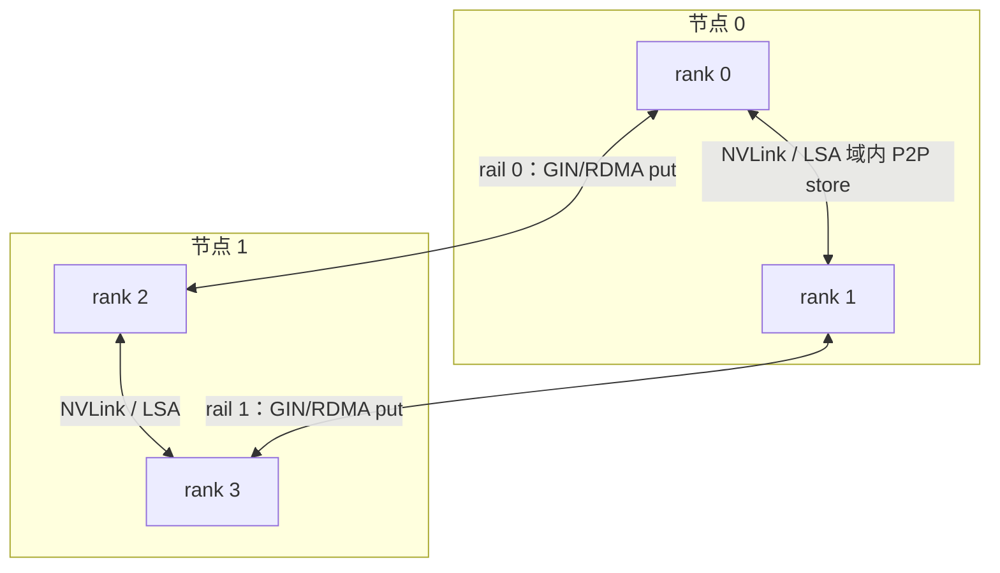

- **LSA team（节点内）**：同节点的 GPU 可直接 store/load 对端显存（LSA，Load-Store Accessible）。`lsa_team_size` 来自 `ncclTeamLsa(comm)`。
- **rail team（跨节点）**：不同节点上"相同节点内编号"的 rank 组成 rail（rank0↔rank2、rank1↔rank3）。每个 token 只跨一次 rail（一次 RDMA put），落到**landing rank**，再由它在本节点内用 NVLink fan-out 给真正需要它的专家（`docs/documentation/benchmark_analysis.md:98-120`）。
- 因此 HT 的路径是两跳：`sender →(RDMA)→ landing rank →(NVLink)→ 目标专家`；token 不换 rail，最多跨两次链路。
- 关键等式：`rdma_team_size * lsa_team_size == nRanks`（`nccl_ep.cc:2786`）。LL 传统语义下 `rdma_team_size = nRanks`。

`relativeRankSlot(sender, receiver, R) = (sender - receiver + R) % R`（`include/common.hpp:258-261`）把各发送方在同一接收方 buffer 里的 NVLink staging 区错开，避免写冲突。

---

## 2. 硬件与系统基础

### 2.1 LSA 与 GIN：两种设备端通信原语

| 原语 | 范围 | 机制 | EP 中的典型用途 |
|---|---|---|---|
| **LSA** | 节点内（NVLink/NVSwitch） | `ncclGetP2pPtr` 拿到对端虚拟地址，直接 `st.global` / `ld.global`，配合 sys-scope fence 发布 | LL 同域 P2P；HT 节点内 G2S/S2G fan-out |
| **GIN** | 跨节点（NIC/RDMA） | `ncclGin::put` + `net.signal(SignalAdd)` + `waitSignal`，window 寻址 | LL 跨节点消息；HT 的 N2N put/signal |

LL 的 GIN context 把 `k` 映射到 `(commId=k/4, ctxId=k%4)`（`device/ll/ll_gin.cuh:18-24`），RDMA 分发用 `ctxHash = slotIdx % numLocalExperts` 打散到多 QP；HT 的 GIN 用 `ginConnectionType=RAIL`、`ginContextCount = num_qp_per_rank - 1`、队列深度按 chunk 数计算（`nccl_ep.cc:2054-2110`）。

### 2.2 TMA、mbarrier、warp 专用化与 SMEM

- **TMA（Tensor Memory Accelerator，Hopper+）**：`cp.async.bulk` 在 global ↔ shared 之间异步搬运整块 token bundle。EP 把它封装为 `tma_load_1d` / `tma_store_1d_no_commit` / `tma_store_commit_group` / `tma_store_wait<N>` / `tma_store_wait_complete<N>`（`device/device_primitives.cuh:978-1024`）。注意后两者语义不同：`wait_group.read N` 只等 SMEM 读阶段结束，`wait_group N`（complete）等全局写真正完成——跨 rank 可见前必须用 complete。
- **mbarrier**：每级流水一对 producer/consumer barrier，用 `mbarrier.arrive.expect_tx` 声明传输字节数；`fence.proxy.async.shared::cta` 让普通 store（如 header）对 TMA engine 可见。
- **warp 专用化**：一个 CTA 内不同 warp 各司其职（RDMA、G2S、S2G、MAP、PAD、REDUCE），通过 `warp_group<W,S>` 别名 + named barrier 协作。HT dispatch 的 head 固定占 3 个 warp（`device/jit/ht_dispatch_jit.cuh:52-81`）。
- **SMEM 拟合**：host 端用双线性模型 `smem = align128(fixed + P·per_pipeline + S·per_stage)`（`device/ht_ep.cuh:713-729`）与 `align128(fixed + G2S·per_g2s + S2G·per_s2g)`（`:1047-1078`）求解 stages/pipelines，显式 env 值不会被自动缩减。TMA epilogue 需要 128 KiB 动态 SMEM 的 opt-in，不满足时回退 CE。

### 2.3 架构代际与能力门控

| 能力 | 门槛 |
|---|---|
| EP 基本运行 | `sm_90+`（Hopper），CUDA 11.8+（推荐 13+） |
| MXFP8 combine（E8M0） | CUDA 12.8+，hidden % 512 == 0；`NCCL_EP_HAS_CUDA_E8M0_TYPE` 编译期门控 |
| NVFP4 | CUDA 12.9+，sm_100/103/107/110/120 类 FP4 target |
| CFT（logical endpoint） | Blackwell+（cc≥10）、CUDA 13.3+、driver API 13030、Fabric Manager |
| NUCS（NVLink 利用率中心调度） | CUDA 头与 driver 均 ≥13.3，`CU_LAUNCH_ATTRIBUTE_NVLINK_UTIL_CENTRIC_SCHEDULING` |

编译期通过 `host_build_supports_fp4()` / `host_build_supports_mxfp8()`（`include/common.hpp:137-148`）探测，运行期通过设备属性与 `validateNcclRuntimeVersion()` 拒绝不兼容组合。

### 2.4 CUDA Graph 与 NCCL Window

- **Window**：`ncclCommWindowRegister(comm, buf, bytes, &win, NCCL_WIN_COLL_SYMMETRIC)` 让 buffer 被远端用 `ncclGetPeerDevicePointer` 寻址。EP 内部大量使用自己注册的 window（LL `rdma_buffer`、HT IPC mega-buffer），用户可通过 `ncclEpTensor_t::win_hdl` 把**自己的** buffer 挂到零拷贝路径。
- **CUDA Graph 约束**：含集合通信/分配的 `CreateGroup`、`InitHandle`、`UpdateHandle`、`MaskClean` 必须在 capture 之前；HT eager 模式的 dispatch 因需 D2H 读计数而被显式拒绝（`nccl_ep.cc:6171-6182`）。LL 的跨轮同步靠设备计数器（expected flag value）在 replay 间自定序。

---

## 3. 总体架构与控制流

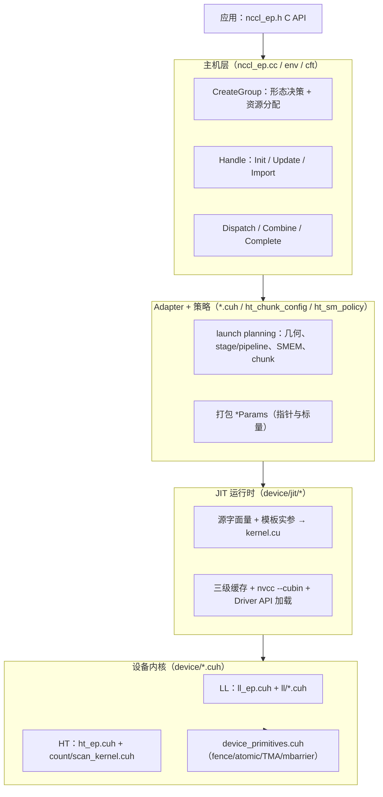

**控制流要点**：host 从不实例化设备模板；它只做"拟合 + 打包参数"，把 `layout / recipe / dtype / topk / 流水线参数` 交给 JIT 变成编译期常量。这样同一份模板源码能覆盖全部特化，而热路径只需一个 `runtime_key` 即可命中缓存。

**两条独立的数据/控制通道**：

- **控制面**：`nccl_ep_env.cc` 解析 env → group config 决议（flow、meta policy、SM、timeout）→ 通过 `ncclAllGatherHost` 保证全 rank 一致 → 形成 `ncclEpGroup`/`ncclEpHandle` 状态。
- **数据面**：设备内核在 `rdma_buffer` / IPC mega-buffer / GIN buffer 上搬运 token，用 flag/counter/fence 自同步；host 仅负责按 stream 顺序入队。

---

## 4. API 与 ABI 机制

### 4.1 Append-only ABI

每个公共结构体以 `size`（偏移 0）+ `magic`（偏移 4）开头，`GroupConfig` 另有 `version`（偏移 8）。发布版本冻结 `XXX_Vn_LAST_FIELD` 与 `XXX_Vn_SIZE`，用 `padding_vN` 吃掉隐式对齐填充（`include/nccl_ep.h:30-122, 368-377`）。

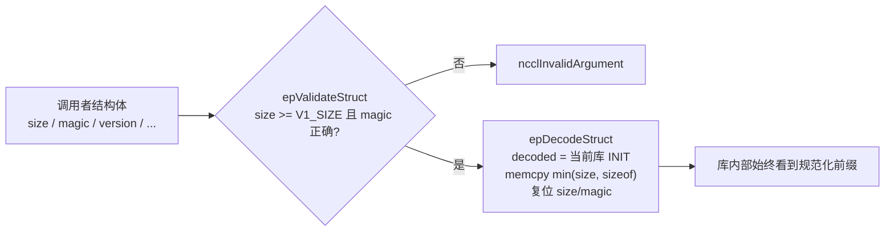

`epDecodeStruct`（`nccl_ep.cc:135-148`）实现双向兼容：旧调用者的小前缀 → 新字段取默认值；新调用者的大对象 → 未知尾部被忽略。所有公开入口都先 validate 再 decode（`CreateGroup:2337/2343`、`UpdateHandle:4847/4851`、`Dispatch:5542-5568`、`Combine:7271-7288`、`ImportHandle:4714/4716`）。

### 4.2 Group / Handle / Tensor / Ops 四层对象

- **Group**：持有 workspace（32 MiB 或 count-only 小 counter 区）、LSA/rail team、devComm、各种 window 与 buffer；所有 rank 必须一致创建。
- **Handle**：连接相关 dispatch/combine 的状态。LL 句柄主要缓存路由与 RDMA 布局偏移；HT 句柄缓存 `sparse_to_dense_map`、LERM、`flat2em_slot_map`、专家计数/偏移、topk 快照等（`nccl_ep.cc:3330-3573`）。同一 group 可同时存在多个 handle，支持 1F1B / pipeline 并行。
- **Tensor**：轻量描述符，用户拥有 `data` 与 `sizes`；库分配的用内部 magic `0xBEEFBEEF` 并带 `sizes_shadow` 防篡改。
- **Ops**：`Dispatch`/`Combine`/`Complete` + AFD 角色包装器 + mask 容错 API。

### 4.3 Handle 生命周期状态机

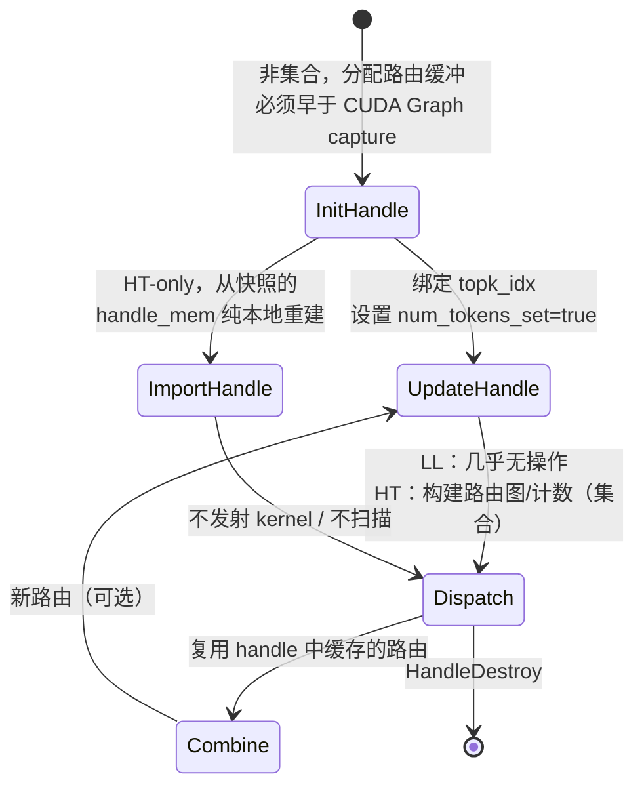

`num_tokens_set`（`nccl_ep.cc:4881-4882, 4773-4774`）区分"合法零 token rank"与"未绑定路由"，Dispatch/Combine 入口强制检查（`:5605, :7312`）。`ImportHandle` 的快照时序有严格要求：FWD dispatch 可在 UpdateHandle 后快照；count-mode 的 BWD dispatch / combine 必须等 FWD dispatch 完成后快照（此时 per-token map 才写入）。

---

## 5. Group 创建：资源与决策

`ncclEpCreateGroup`（`nccl_ep.cc:2329-3197`）是 32 步的集合流程，可归纳为五个阶段。

### 5.1 校验与派生量

- 校验 NCCL 运行时兼容、struct ABI、算法/策略合法性、AFD 约束、HT `max_token_bytes % 16 == 0`、两算法都要求 `max_dispatch_tokens_per_rank > 0`。
- 派生量：`num_local_experts = num_experts / (nRanks - num_attn_ranks)`；`eager_mode = HT && max_recv_tokens == AUTO`，内部上界 `= nRanks × max_dispatch × max(num_topk, 1)`；`num_qp_per_rank = 保留 GIN ctx + dispatch_sms × N2N_WARPS(2)`。

### 5.2 SM 预算优先级（从低到高）

```
算法默认（HT: Rubin EM=32 / 其它 EM=24 / flat=16；LL: 全部 SM）
  < max_num_sms（legacy 共享 config）
  < dispatch_num_sms / combine_num_sms（op config）
  < NCCL_EP_COMM_SMS（legacy 共享 env）
  < NCCL_EP_DISPATCH_SMS / NCCL_EP_COMBINE_SMS（op env）
```

实现见 `nccl_ep.cc:2519-2589`；LL 还校验 `ceil(num_experts/sms) <= kLlDispatchMaxWarpGroups(14)`，超限返回所需最小 SM 数。

`timeout_cycles`（`:2694-2760`）按 `NCCL_EP_TIMEOUT_MS > config.timeout_ns > 编译默认(200G cycles≈100s)` 解析，用设备 clock kHz 换算并饱和乘法，避免溢出。

### 5.3 HT flow / 专家复制模式决策树

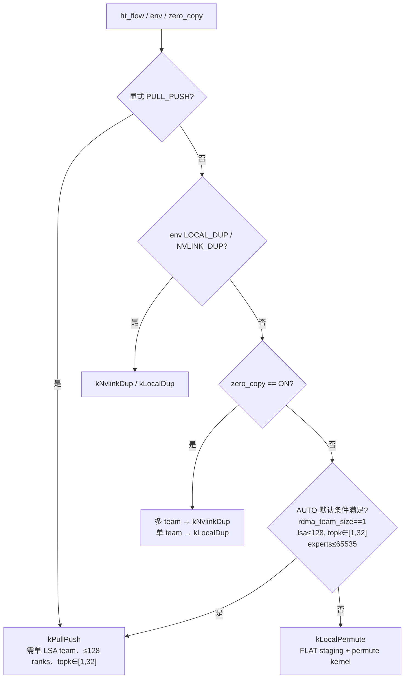

四种模式（`enum class HtEmMode`，`nccl_ep.cc:894-899`）决定 staging 区大小、索引方式、flow 和 kernel 组合。冲突（如 local_dup + nvlink_dup）直接 `ncclInvalidUsage`；所有 rank 的决议必须一致。

### 5.4 全 rank 一致性投票（`LlGroupVote`）

LL 创建时把 `num_attn_ranks / want_cft / enable_mask / zero_copy / CFT facts & floors` 打包成 `LlGroupVote`（`nccl_ep.cc:3019-3027`），`ncclAllGatherHost` 后逐字段校验（`:3036-3126`）。任何不一致 → `reject_group` 统一回滚，避免部分 rank 进入 fabric endpoint 建立/mask window 注册而后卡死。CFT 还要求 `props.nLsaTeams == 1` 且与 masking 互斥。

### 5.5 资源布局

- `ep_workspace` 默认 32 MiB；count-only HT 组只需 `align256((2·nRanks + num_experts + 2)·4)` 字节的小 counter 区（`:2883-2903`）。
- **HT IPC mega-buffer**（`init_ht_intranode`，`:1349-1722`）：一次 `ncclMemAlloc` 按 256B 对齐切成六段——dispatch token staging、dispatch prob、count meta tables、combine token staging、combine prob、pull meta。`skip_token_staging = zero_copy && !pull_push` 时省略 token 段；各段公式在 `:1398-1485`。另有 `dev_counter_block`（40B）保存 expected GIN/LSA flag 与 grid-barrier 计数，`host_ptr_block`（mapped host memory）保存每 LSA rank 的 peer 指针数组。
- **HT GIN mega-buffer**（`init_ht_internode`，`:1868-2129`）：4096B 对齐，切出 combine RED/G2S token/prob、dispatch/combine G2S flags、guard、staging、RDMA send/recv packed 区；`num_ctx = num_qp_per_rank - 1`，signal 总数包含 streaming head/tail 与 32 个 barrier 保留位。
- **LL `rdma_buffer`**：见下一节布局；`AUTO` 时延迟到首个 handle 按需 realloc（集合操作），显式大小则创建时精确分配且永不增长。

---

## 6. LL 内核实现机制

### 6.1 缓冲布局与双 bank

`LowLatencyLayout`（`include/common.hpp:443-583`）把整块 `rdma_buffer` 拆成两组双 bank：

```
payload bank（bank = epoch & 1）
  ├─ dispatch send + recv（共享槽，经典拓扑取两者和的 max）
  └─ combine send + recv（与 dispatch 共享同一 payload 槽）
signal bank（bank = epoch & 1，slot_stride 按 128B 对齐）
  ├─ [signal]   dispatch recv-count / combine recv-flag，0 = 未到达
  ├─ [read_done] combine 1-sided 读完成标志
  └─ [total_token] combine 1-sided 的 token 数发布
slot_base = 2 × signal_slot_stride
```

关键公式：`num_bytes_per_dispatch_msg = align(4 + topk·routerSize, 16) + max_token_bytes`，其中 routerSize 为 8（RANK_MAJOR，携带 fp32 权重）或 2（EXPERT_MAJOR）；`signal_slot_stride = align(signaling + read_done + total_token, 128)`；所有 buffer 大小断言为 `int4` 倍数（`common.hpp:316-321, 503-581`）。

设备侧解析（`device/ll_ep.cuh:587-600`）：
```
bank = epoch & 1
sendOff    = sendOffBase    + bank × payloadSlotStride
recvCntOff = recvCntOffBase + bank × signalSlotStride
bank_next  = bank ^ 1   // 控制 warp 提前清零下一 bank 的信号区
```

### 6.2 Epoch 状态机（`send_only` + `Complete` 的本质）

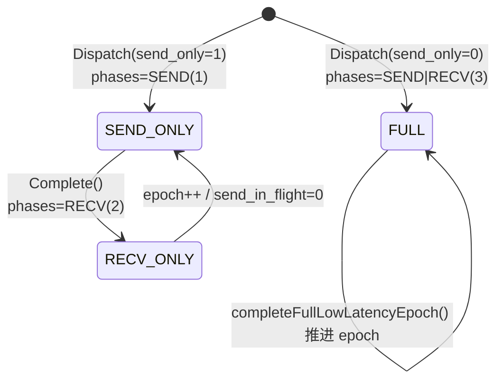

`selectLowLatencyEpoch`（`device/ll/ll_common.cuh:18-40`）由 `(smId==0 && threadId==0)` 维护 `pending_epoch / send_in_flight`：SEND-only 记录 epoch，RECV-only 取同一 epoch 并在完成后 `++epoch`。同步内核由 `completeFullLowLatencyEpoch` 推进：有 grid 屏障时由 sm0 推进（重载 A），LSA 无屏障时由 last-CTA 推进（重载 B，`:46-72`）。`send_only` 的续跑 lambda 存在 `handle->ll.continue_fn`（`nccl_ep.cc:6025-6027, 7587-7593, 8131-8144`）。

### 6.3 LL Dispatch：一次完整的数据流

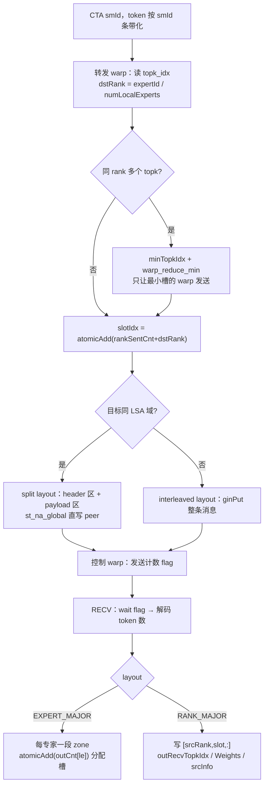

**关键精确编码**（`device/ll_ep.cuh:292-317, 321-385`）：

| 事件 | P2P（LSA） | GIN（RDMA） |
|---|---|---|
| 发送 n 个 token 的到达 flag | `st.release.sys` 写 `-(n+1)`（0=未到达） | `SignalAdd(signalId, n+1)` |
| 接收解码 | `n = -value - 1` | `waitSignal(≥1)` → `n = -value - 1` |
| 消费后 | 清零该字，供两轮后 bank 复用 | `resetSignal` |
| 超时 | `printf` + `rankMask[src]=0` + `asyncErrorFlag=1`（无 mask 则 `trap`） | 同左 |

**无 grid 屏障的计数点火协议**（通用内核，`:935-983`）：每个 CTA 的 `rankDone[dstRank]` 累加三部分——转发 warp 每消息 `+1`（`:823-826`）、sm0 广播 `+FINISHED_SUM_TAG`（`:873-877`）、控制 warp 补 `+(FINISHED_SUM_TAG - countsSent)`（`:923-930`）。由于 `countsSent` 恰等于去重后的发送数，三项相加恒等于 `2×FINISHED_SUM_TAG = 32768` 当且仅当所有 CTA 的 SEND 写完成；发布方以 `ld.acquire.gpu` 自旋该值后再发 count flag，从而无需 grid 同步。

**LSA 变体的 last-CTA 协议**（`device/ll/ll_dispatch_lsa.cuh:319-413`）：
```
__syncthreads()
末 warp lane0: prev = atomic_add_release_global(ctaDone, 1); isLast = (prev+1 == numSms)
if isLast:
  memory_fence_acquire_gpu(); __syncwarp()      // 与所有 CTA 的 release 原子配对
  memory_fence_release_sys()                    // 把本 rank 所有写发布到全系统
  for each peer: st_relaxed_sys(recvCntBuf+peer, -numTokensSent-1)
  清零 rankSentCnt[] 与 ctaDone[0]
__syncthreads(); return isLast
```
因为 last CTA 构造上知道所有其它 CTA 已完成写入，所以可就地清零计数器供下一 epoch 使用，省掉 `cg::this_grid().sync()`。接收侧 `syncAndRecvCounts`（`:425-464`）用 `ld.relaxed.sys` 并行轮询各 peer + 一次 `fence.acquire.sys`，把各 peer 的到达延迟重叠起来。

### 6.4 LL Combine：2-sided 与 1-sided

- **2-sided**：发送方把专家输出 TMA-store 到对端 recv 区，发 finish flag=1；接收方 `waitForRecvFlag` 轮询并在消费后清零。Expert-major 在接收侧按 `topkWeights` 加权累加；rank-major 权重由调用方预折，kernel 用 `weight=1`（`ll_ep.cuh:2286-2307`）。
- **1-sided（pull）**（`device/ll/ll_combine_lsa.cuh:836-1076`）：本端不发 token，只广播"inData 可被拉取"；接收侧按 dispatch 记录的 `dstInfo`（dstRank, slotIdx）用 `ncclGetPeerPointer` 直接 TMA-load 对端数据，完成后广播 read-done，靠 `waitForAllReadDoneDistributedLsa` 保护 inData 不被下一轮覆盖。
- **auto**：设备端读 `want1SidedBuf`（由 dispatch 的 `computeAndPublishWant1SidedLsa` 按 `numTokens > NCCL_EP_COMBINE_LSA_1SIDED_THRESH`（默认 512）生成），在设备入口选择 1-sided 或 2-sided，无 host 往返。

### 6.5 CFT、Mask 与 AFD

- **CFT（`nccl_ep_cft.cc`）**：用 `cuLogicalEndpoint*` 动态解析（driver API 13030）避免 dlopen 硬依赖；`cuMemCreate(FABRIC)` 建接收缓冲，export/import handle 经 `ncclAllGatherHost` 交换；payload 靠硬件 byte counter 判断到达（`cumul_byte_expect_dev`，per (peer,expert,parity) 累计），token 数仍走 recvCntBuf。port binding 要求全 rank 的 offset/bytes 与 rank0 一致；CFT 与 masking 互斥、不支持 FWD recipe、禁止 graph capture 内首次绑定。
- **Mask（`device/ll/ll_mask.cuh`）**：超时则 `rankMask[peer]=0`；`MaskClean` 用独立 window 做 mask-aware barrier（NVLink peer 直接 P2P store，RDMA peer 用 GIN barrier signal），清零两个 bank 的 signal/read-done 区后全部置 1；`asyncErrorFlag` 需单独 `ErrorClear`。
- **AFD**：`num_attn_ranks` 把 rank 分为 A（有 token）/F（有专家）；角色作为 JIT 模板常量 `kRankOwnsTokens/kRankOwnsExperts`，A-rank 二进制在 RECV 标签直接 return；recv 区只给 attention 源 rank 行，`dispatchSourceRankSlot<kAfd>` 做旋转映射。

### 6.6 LL Adapter 几何与模板分发

`call_dispatch`（`device/ll_ep_adapter.cu:94-138`）：
```
numWarpGroups     = ceil_div(numExperts, numDeviceSms)
numWarpsPerGroup  = 32 / numWarpGroups        // DSFP8 staged quant 可压缩到 16 线程组
numWarps          = numWarpGroups × numWarpsPerGroup
numSms            = ceil_div(numExperts, numWarpGroups)   // = gridDim.x
约束：numTopk + kLlDispatchControlWarps(1) <= numWarps
```
`ll_dispatch_select_algo`（`device/jit/ll_dispatch_jit.cuh:53-95`）按 `nvlinkOnly / recipe / layout / hidden` 在 `kDefault`（通用）、`k2SidedRmLsa`、`k2SidedRmLsaTma`（默认 LSA）、`kCftRmLsa` 间选择；TMA 流水 stage 数在 host 端由 `dispatch_tma_smem::choose_config` 按 hidden/dtype/SMEM 一次算定，`cluster_dim_x=2`（SM 偶数时）共享分布式 SMEM。

---

## 7. HT 内核实现机制

### 7.1 三条设备流水线

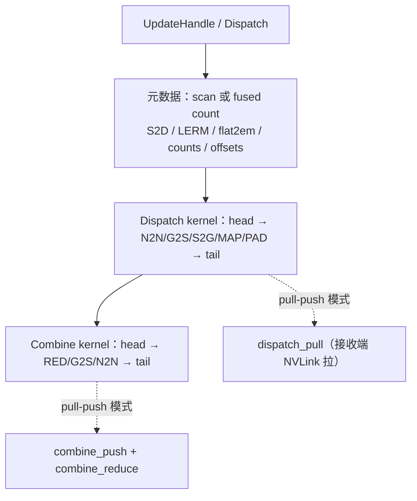

### 7.2 元数据：scan 与 fused count

**（a）scan 路径**（`device/scan_kernel.cuh`）：`scan_impl_flat`（`:1046-1246`）四阶段——
1. `extract_lsa_ranks_meta`：从 bitmap / topk_idx 构造 `token_rank_mask`，统计每 rank 命中，写 `rdma_to_attn_map`；
2. 跨 block 前缀扫描（decoupled look-back，`:291-338`）：`block_prefix[x] = Σ 前驱 block 的 rank_sums`，EM 另得 `expert_block_prefix / expert_total`；
3. `assign_recv_slots`（`:540-716`）：warp 排他扫描得到 FLAT 的 `[token][dest rank] → slot`；
4. `write_local_routing` / `build_em_tables_impl`（`:1394-1680`，cooperative + grid.sync）：写 LERM、flat2em、专家 zone base、counts/offsets，并填 `recv_total_counter`。

**（b）fused count 路径**（`device/count_kernel.cuh:32-94`）：只产生每 token 的直方图 `cnt_rank / cnt_expert / own_chunk_rank / token_dst_rank_bitmap`，S2D/LERM/offset 的构造**移入 dispatch kernel**：

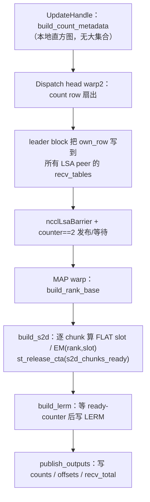

`count row` 布局为 `[cnt_rank(num_src_ranks) | cnt_expert(num_experts)]`（`ht_ep.cuh:5035`）。head 扇出用 `elect_first_block_warp` 选领导者，写完后 `ncclLsaBarrierSession` + `st_release_gpu_global(counter,2)`，其它 block 自旋到 2 再 `ld_acquire`（`:5224-5268`）。unfused 路径则在 UpdateHandle 里 `ncclAllGather` 到 `cached_cnt_rows`，省掉 head 扇出。

**s2d_chunks_ready 协议**（`:1899-1907, 4757-4761`）：生产者用 `st_release_cta` 递增 ready counter（发布前 `__threadfence()` + `fence_proxy_async()`），消费者 `s2d_unit_wait` 用 `ld_relaxed_cta` 自旋阈值 + acquire fence。**G2S 与 S2G 必须等同一 counter**，否则会读到彼此已清掉的 map 而 desync FIFO。

路径选择在 `nccl_ep.cc:4930-4968`：`early_layout = layout_info 带 expert_counters/recv_total_counter` → unfused；`eager` / `force_unfused` → unfused；`REQUIRE_FUSED` 策略逐项拒绝不兼容配置（`:1102-1134`）。

### 7.3 Dispatch kernel 阶段（push-pull）

`dispatch_kernel_impl`（`device/ht_ep.cuh:5137-5482`）：

| 阶段 | warp | 关键动作 |
|---|---|---|
| head | warp0 | 初始化 mbarrier（每 pipeline/stage 一对 producer/consumer）+ `fence_proxy_async` |
| head | warp1 | 跨轮 RDMA guard wait（`peer_flags[peer]+1 < expected`） |
| head | warp2 | count row 扇出 + LSA barrier + counter 发布 |
| N2N | 2 warps/team | `ncclGin`：packed entry `[token|prob|scales]` 按 `__ballot_sync` 压紧写；同 QP 发 tail signal；`GIN_WINDOW=8` 滑动窗口 |
| G2S | 1 warp/pipeline | 读 `rdma_to_attn_map` 判定所需 token → TMA load 进 stage，等 consumer mbarrier |
| S2G | 1 warp/pipeline | 解码 S2D（FLAT: `rank+slot`；EM: 打包 `[31:22]=rank,[21:0]=slot`）→ TMA store 到 peer 的 expert_output；`IN_FLIGHT_S2G=4` 流控 |
| MAP | 2 warps | count 模式构建 S2D/LERM/counts（见 7.2） |
| PAD | 1 warp | EM 对齐区零填充；DROP 时用 `pad_room` 截断防越界 |
| tail | last block | `red_add_release_sys(lsa_S2G_flags,1)` → 等 expected value → 复位 barrier counter → 推进 expected flag |

flag 期望值协议是 CUDA Graph replay 自定序的关键：`dispatch tail` 与 `combine head` 对同一 flag 做"加 1 并等期望值"；每轮 `*expected_lsa_flag_val += ranks_per_lsa_team`，`*expected_gin_flag_val = expected + 1`（`:5450-5465, 5597-5603`）。

### 7.4 push-pull 与 pull-push 对比

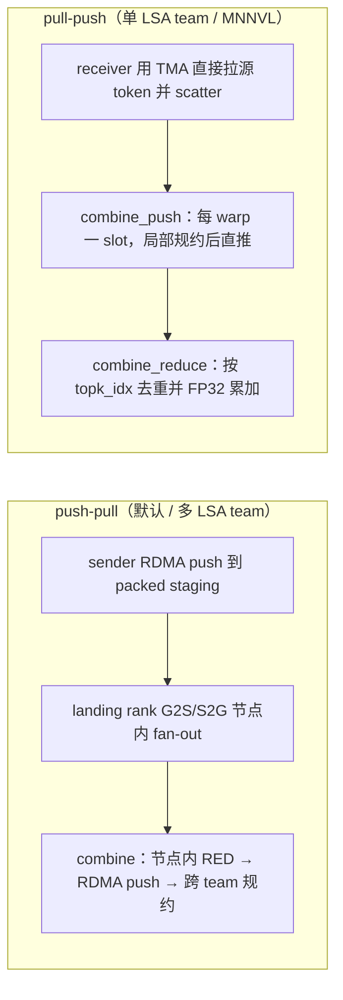

- **pull-push** 的 head/tail 换成 `lsa_grid_head_gate` / `lsa_grid_tail_barrier`（`:6896-6942`）：leader 做 LSA barrier 后置 ready flag，waiter 自旋 + acquire；tail 做 `__threadfence_system()`、barrier、重置 pool counter。
- `combine_push`（`:8375-8723`）：每 warp 一 recv slot（32 lane），`combine_push_claim_t` 动态认领行（阈值 `NCCL_EP_HT_COMBINE_DYNAMIC_CLAIM_MIN_TOKENS=512`），一行 TMA store 到远端 `[t×team_size + R]`；BWD 权重散布到 token 行尾 pad。
- `combine_reduce`（`:8752-8926`）：用 `__match_any_sync` 对相同源 rank 去重，按 `kUnroll=2 / kRankGroup=4` 批量累加 `float2`。

### 7.5 Combine 归约与数据流

`combine_kernel_impl`（`:5519-5843`）的 warp 组：LSA_RED（多 team 时 4 warp）、CROSS_LSA_RED（4 warp）、LSA_G2S、CROSS_LSA_G2S（P warp）、GIN（N2N）。核心累加 `combine_reduce_dst_token`（`:2750-2869`）：

```
acc_token_fp32[NUM_ACC] 清零，NUM_ACC = ceil((H/2)/((RED_WARPS/P)×32))，上限 64
do:
  mbarrier_try_wait_parity(producer) → arrive_and_wait(RED group)
  for n in [0,NUM_ACC): acc += ld_token_pair<dtype>(...)   // MXFP8 在此处反量化
  BWD: acc_prob[n] += 梯度
  mbarrier_arrive(consumer); ring advance
while !last_src_token
```

`NCCL_EP_COMBINE_MAX_ACC=64` 保证寄存器驻留；H=16384 时 host 自动降 pipeline。`NCCL_EP_HT_COMBINE_RDMA_STREAMING_BATCH=8` 让 RED warp 每 8 个 token 向 RDMA warp 发布产量，做到"边收边发"。

### 7.6 Overflow、Eager 与 compact-prob

**Overflow**（仅 HT）：两处检查——库 staging（去重 token 行）和调用方输出（FLAT 去重；EM 是 token×专家对 + 对齐 pad，故 EM 更易先溢出）。`DROP` 链路是"先门控、再 clamp、再 zero-fill"（`ht_ep.cuh:329-336` 等）：

1. `drop_overflow_slot` 把越界槽置 -1；S2G/LERM 跳过；
2. counts/offsets clamp 到 `recv_max_slots`，但 `recv_total_counter` 恒报 **pre-drop** 真实总数；
3. scan 路径闭式重算 delivered counts；
4. 完全丢弃 token 的 `rdma_to_attn_map` 置 false，避免 combine 等待不存在的 partial（否则死锁）；
5. PAD warp 零填充 phantom row。TRAP 模式在 14 处站点 `__trap()` 并先 `printf` 可操作提示。

**Eager**：按实际 recv 数分配输出；EM 必须设 `num_topk`；禁 graph capture 与 DROP；固定容量的 TMA/SIMT copy epilogue 用设备计数做 SM 拷贝，避免 host 读回。

**compact-prob**：线格式 `[K×FP32 权重][K×uint16 全局专家 id][补零到 16B]`（K=10 → 64B），仅当严格小于 dense 才启用（`docs/documentation/ht_compact_prob.h:13-53`）。接收端 `compact_prob_to_output`（`device/ht_compact_prob.cuh:55-164`）用 LERM 作为"真实 payload 守卫"，防止读到未写的 EM padding；`SortedTopk` 按专家序用 `compact_find_pos` 定位源列，否则按源顺序扫描；同时写 `positions` 供 BWD 散射权重。

---

## 8. 运行时 JIT 机制

### 8.1 为什么必须 JIT

kernel 特化维度 = 算法 × layout × dtype × topk × recipe × warp 数 × LSA 模式 × 架构 × 流水线参数，AOT 穷举不可行。JIT 把这些变成模板实参，hot loop 内无分支。**AOT 只编译 host 胶水与两个 adapter**，`__global__` kernel 定义在 `.cuh`，运行时拼源码调用 `nvcc --cubin`。

### 8.2 热/冷双路径与三级缓存

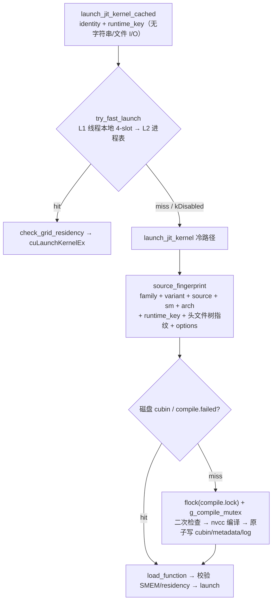

- L1：`thread_local` 4 slot，无锁；L2：`unordered_map<FastCacheKey>` + `shared_mutex`；L3：磁盘 cubin，根 `NCCL_EP_JIT_CACHE_DIR` 否则 `/tmp/nccl_ep/jit`。
- `FastCacheKey = {identity, runtime_key, CUcontext, device}`（`device/jit/jit_runtime.cc:82-105`）；`identity` 是每个 kernel family 的静态地址，LL dispatch 有 4 个（通用 / LSA SIMT / LSA TMA / CFT）。`runtime_key` 由 `runtime_key_mix()` 无堆分配 FNV 折叠得到。
- 磁盘键 `source_fingerprint`（`:307-320`）包含**完整 source 文本、编译器 ID、全部头文件的树指纹、编译选项**；改头/换编译器/改 flag 自动失效，旧条目不回收，删缓存目录安全。
- 编译工件：`kernel.cu / kernel.cubin / compile.log / compile.failed / metadata.json / compile.lock`；`write_file_atomic`（临时文件 + rename）保证并发读者看不到半 cubin；失败写 `compile.failed` 持久化 + 进程内 `failed_keys_` 短路，并回退静态路径（`warn_once "using static path"`）。
- `launch_function`（`:530-588`）把 variant 字段映射为 `CU_LAUNCH_ATTRIBUTE_NUCS / COOPERATIVE / CLUSTER_DIMENSION` + `cuLaunchKernelEx`。LL 默认 `cooperative=true`（`cg::this_grid().sync()` 依赖）且 `cluster_dim_x=2`。

### 8.3 枚举到模板实参的翻译

`jit_source_literals.hpp` 提供 `layout_literal`（`NCCL_EP_LAYOUT_*`）、`dispatch_recipe_literal`、`combine_recipe_literal`、`token_dtype_literal`、`bool_literal` 等，把 host 枚举转成 C++ token；`*_name_tag` / `*_cache_tag` 同步拼进 `variant_name`。例如 HT MXFP8 combine 生成：

```cpp
#include "device/ht_ep.cuh"
extern "C" __launch_bounds__(...)
__global__ void nccl_ep_jit_ht_combine_kernel(
    const __grid_constant__ ht_ep::combine_kernel_param_t<LSA_TEAM_SIZE> p) {
  ht_ep::combine_kernel_impl<..., NCCL_EP_LAYOUT_EXPERT_MAJOR,
                             ncclBfloat16, NCCL_EP_COMB_QUANT_MXFP8>(p, smem);
}
```

未知枚举用 `abort` 或 `nullptr` 显式失败，避免静默误编译；HT 常用 `std::hash(variant_name)` 作 runtime_key，避免手工位域在字段溢出时静默别名。

---

## 9. 量化 Recipe 的底层实现

| Recipe | 范围 | 线格式 / 数学 |
|---|---|---|
| `DISP_QUANT_FWD` | LL+HT dispatch | token 与 scale 按物理字节转发，不转换；`round_scales=0`，行与基址 16B 对齐 |
| `DISP_QUANT_DS_FP8E3M4` | LL dispatch | BF16→E4M3 + 每 128 元素一个 FP32 逆 scale；hidden % 512 == 0 |
| `COMB_QUANT_NVFP4` | LL combine（实验） | E2M1 + FP8 block scale + 调用方 FP32 全局 scale |
| `COMB_QUANT_MXFP8` | HT combine | BF16→FP8 E4M3 + 每 32 元素一个 E8M0 scale，内部生成，hidden % 512 == 0 |

**MXFP8 的关键位技巧**（`device/mxfp8_quant.cuh`）：
- 解码 `e8m0_to_scale(e) = __uint_as_float(uint32(e) << 23)`，即精确的 `2^(E-127)`；
- 编码 `float_to_e8m0` 用 `ceil(log2(amax/448))`，封顶 `0xFE`（`0xFF` 是 E8M0 的 NaN）；
- 逆 scale 在 `e==0xFE` 时特判为 `__uint_as_float(0x00400000)`（`2^-127` 的次正规数），否则朴素 `(254-e)<<23` 会下溢为 0，使 Inf 块变成 NaN；
- RED 循环用 `mxfp8_red_map` + `ld_fp8_pairs_shared` 让一次 16B load 共享一次 E8M0 读取。

**DSFP8**（`device/ll/ll_dispatch_recipe.cuh:68-101`）：`kLanesPerScale = 128/4 = 32`（半 warp 共享一个 scale），`quantizeDsFp8Vector` 先半 warp `warp_reduce_max` 求 amax，再 `calculate_fp8_scales` 得 scale/scale_inv，最后 `__nv_cvt_float2_to_fp8x2(SATFINITE)`。TMA 路径用独立量化 warp 把结果**原地覆盖** BF16 stage，并通过 `tma_store_fence` / `quantReady` 与控制 warp 排序。

`combine_recipe_traits` 主模板**故意未定义**（`device/quant_recipe.cuh:26-28`），新增 recipe 必须补齐所有几何与 RDMA 能力——这是编译期的强约束。

---

## 10. 零拷贝、溢出、Eager 与弹性缓冲区

### 10.1 零拷贝

用户把 buffer 注册为 window 并挂到 `ncclEpTensor_t::win_hdl/win_offset`，payload 不再经过库 staging。HT 支持 dispatch 输出 / combine 输入直写；LL 仅 dispatch 直写、combine 始终 staging。`zero_copy=ON` 会省略 HT token staging 区并切换专家复制算法（local-dup / nvlink-dup），因此它同时是性能与内存决策。EM 三种 recipe 的映射：

| zero_copy | LSA teams | 专家复制方式 |
|---|---|---|
| 非 ON | 任意 | FLAT staging + permute kernel |
| ON | >1 | 发送端每专家一份 NVLink 拷贝 |
| ON | 1 | 接收端 local-dup 扇出 |

### 10.2 溢出策略

`TRAP`（默认）在 14 处站点 `__trap()`（销毁 CUDA context，不可恢复）；`DROP` 丢弃越界 token 并继续。注意 `DROP` **不允许缩小接收缓冲区**（必须仍按 `max_recv_tokens_per_rank` 分配），且与 eager 互斥。诊断方式：比较 `recv_total_counter`（真实前 drop 值）与 clamp 后的计数。

### 10.3 弹性接收缓冲区（业务延伸）

`docs/documentation/elastic_buffers.md` 描述了 GPU+CPU 分段 VA：GPU 段覆盖常见接收量，CPU（HOST_NUMA）段吸收长尾，用 `cuMem*` 映射。**仅 EM + 两个 dup 开关关闭**的路径支持——因为只有该路径用 kernel 的 SASS load/store 读写接收区；FLAT 路径用 `cudaMemcpy`/`cudaMemset` 会在 HOST_NUMA 指针上崩溃；window 直写 CPU 段因 device-scope fence 不足尚不支持；LL 尚未支持。这是"硬件能力 → API 约束"的典型例子。

---

## 11. 环境变量、兼容性与工程约定

### 11.1 关键环境变量（按用途）

| 类别 | 变量 |
|---|---|
| 诊断 | `NCCL_EP_DEBUG`、`NCCL_EP_ENV_VERBOSE`、`NCCL_EP_JIT_LOG` |
| HT flow / 元数据 | `NCCL_EP_HT_PULL_PUSH`、`NCCL_EP_HT_EM_LOCAL_DUP`、`NCCL_EP_HT_EM_NVLINK_DUP`、`NCCL_EP_HT_AG_SCAN_MODE`、`NCCL_EP_HT_COUNT_UNFUSED`、`NCCL_EP_HT_RECV_TOPK_ORDER` |
| HT 几何 | `NCCL_EP_COMM_SMS`、`DISPATCH_SMS`、`COMBINE_SMS`、`TOKENS_PER_CHUNK`、`DISPATCH_TOKENS_PER_CHUNK`、各 `NUM_STAGES/NUM_PIPELINES` |
| LL 内核 | `NCCL_EP_DISPATCH_LSA={simt,tma,universal}`、`NCCL_EP_COMBINE_LSA={2sided,1sided,universal}`、`NCCL_EP_COMBINE_LSA_1SIDED_THRESH`、`NCCL_EP_LL_TMA_QUANT_WARPS`、`NCCL_EP_LL_CFT` |
| JIT | `NCCL_EP_HOME`、`NCCL_EP_JIT_NVCC`、`NCCL_EP_JIT_CACHE_DIR`、`NCCL_EP_JIT_SOURCE_DIR`、`NVCC_ARCH_FLAGS`、`NVCC_EXTRA_FLAGS` |
| 超时 | `NCCL_EP_TIMEOUT_MS` |

`nccl_ep_env.{h,cc}` 只做类型化解析（flag/ulong/choice），范围检查和默认值由各读取点负责。

### 11.2 NCCL 运行时兼容

`validateNcclRuntimeVersion`（`nccl_ep.cc:2249-2282`）：runtime==build 直接通过；build≥2.31 可配更新 runtime；build∈[2.30.5,2.31) 配更新 runtime 时自动 `setenv("NCCL_DEV_API_JIT","1",0)`；其余拒绝。**runtime 不得旧于 build**；JIT 头必须来自与 runtime 相同的 NCCL 安装。

### 11.3 工程约定

- `.clang-format-ignore` 排除 `nccl_ep/**`（迁移期避免分歧）：不要整目录 reformat，遵循 `docs/agents/CODING_SKILL.md`（禁默认参数、禁嵌套三元、inline asm 只在 `device_primitives.cuh`、复用 `ceil_div/align` 等）。
- `docs/agents/PLC_DOCS_SKILL.md`：PLC 设计文档永不编辑旧文档，新文档目录须以 MR 号前缀；本文不是 PLC 文档，故置于 `docs/` 根目录。
- 提交需 `git commit -s`（DCO）。

---

## 12. 设计哲学与关键不变量

> 让 GPU 主导通信：host 只做资源准备、拓扑决策与 launch planning；数据搬运和同步全在设备端用 LSA/GIN + fence/flag 完成。用 **append-only ABI + 拆分 handle 生命周期**换取兼容性与 CUDA Graph 支持；用**双 bank epoch + flag/counter 协议**实现无 host 参与的跨调用流水；用**运行时 JIT + 指纹缓存**消化特化维度爆炸；用**拓扑感知的 LL/HT 双内核 + 零拷贝 / 量化 / 容错开关**覆盖从亚毫秒推理到大规模训练的完整频谱。

必须守住的不变量：

1. **集合一致性**：所有涉及"全 rank 必须一致"的决策（预算、CFT vote、flow、pull-count capability、window binding）都经 `ncclAllGatherHost` 形成栅栏，失败统一回滚；
2. **flag 期望值**：dispatch tail 与 combine head 对同一 flag "加 1 并等期望值"，每轮按 `ranks_per_lsa_team` 推进——这是 CUDA Graph replay 自定序的基础；
3. **bank 轮转**：只有 RECV 半（或同步内核的 send 边界）推进 `epoch`，SEND-only 只记录 `pending_epoch`；
4. **S2D ready-counter**：G2S 与 S2G 必须等同一个 `s2d_chunks_ready`，否则 FIFO desync；
5. **DROP 发布顺序**：先门控、再 clamp、再清 combine gate、最后 zero-fill；
6. **量化对齐**：所有 token/scale 行、基址、window offset 满足 16B 对齐；MXFP8 / DSFP8 额外要求 hidden % 512 == 0；
7. **协议编码**：LL 到达 flag `-(n+1)`（0=未到达）；`FINISHED_SUM_TAG=16384`、点火阈值 `32768`；`ctaDone` 以 `prev+1==numSms` 选 last CTA。

---

## 13. 关键源码索引

| 主题 | 位置（`nccl_ep/` 下） |
|---|---|
| API / ABI | `include/nccl_ep.h`、`include/ep_enums.h` |
| 通用常量 / LL 布局公式 | `include/common.hpp:18-51, 375-625` |
| Group 创建 / Handle / Ops | `nccl_ep.cc:2329` / `:3330` / `:5535, 7265, 8131` |
| HT 资源布局 | `nccl_ep.cc:1349-1722`（intranode）、`:1868-2129`（internode） |
| UpdateHandle 决策树 | `nccl_ep.cc:4840-5273` |
| LL epoch / 计数 | `device/ll/ll_common.cuh:18-72, 154-220` |
| LL dispatch / combine 内核 | `device/ll_ep.cuh:497, 1780` |
| LL LSA / TMA 变体 | `device/ll/ll_dispatch_lsa.cuh`、`device/ll/ll_combine_lsa.cuh` |
| LL 内存原语 | `device/device_primitives.cuh`（fence/load/store/atomic/TMA/mbarrier 全表） |
| HT 元数据 | `device/count_kernel.cuh:32`、`device/scan_kernel.cuh:1046, 1394` |
| HT dispatch / combine 内核 | `device/ht_ep.cuh:5137, 5519` |
| HT pull/push | `device/ht_ep.cuh:6944+`（pull）、`:8375, 8752`（push/reduce） |
| HT 几何 / 策略 | `ht_chunk_config.hpp`、`ht_sm_policy.hpp`、`device/ht_ep_configs.cuh` |
| compact-prob | `ht_compact_prob.h`、`device/ht_compact_prob.cuh:55` |
| JIT 编排 | `device/jit/jit_runtime.cc`、`nvcc_compiler.cc`、`jit_source_literals.hpp` |
| 量化 | `quantization_recipe.hpp`、`device/quant_recipe.cuh`、`device/mxfp8_quant.cuh`、`device/ll/ll_dispatch_recipe.cuh` |
| CFT | `nccl_ep_cft.cc/.h` |
| 设计文档 | `docs/documentation/{jit, quantization, zero_copy, overflow_policy, eager_mode, benchmark_analysis, elastic_buffers}.md` |
| 内部 agent 规范 | `docs/agents/{CODING_SKILL, PLC_DOCS_SKILL}.md` |
